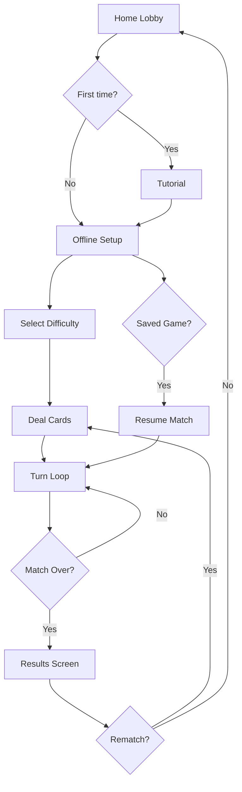
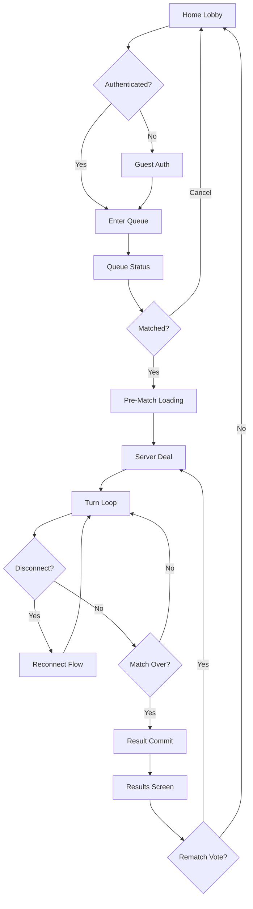
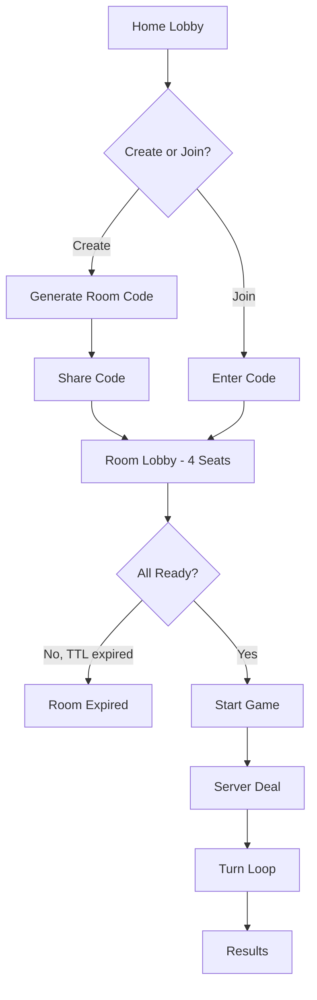

# 01 — Product Requirements Document and User Stories

**Document ID:** DM-DOC-01  
**Version:** 0.1 DRAFT  
**Date:** 2026-10-20  
**Status:** Awaiting owner approval — do not implement

---

## Purpose

Translate the product vision into actionable feature requirements with user stories, acceptance criteria, screen inventory, and user flows. This is the feature-level contract that Phase 2+ implementation must satisfy.

## Scope

Covers all MVP functional requirements (FR-01 through FR-15), user stories per requirement, screen inventory, user flow diagrams, localization and accessibility requirements, and post-MVP feature boundaries.

---

## 1. Functional Requirements — MVP

### FR-01: Onboarding

**As a** new user, **I want to** choose my language and start playing immediately as a guest, **so that** I can enjoy the game without creating an account or needing a network connection.

| Acceptance Criteria |
|---|
| AC-01-1: App presents language selection (English / Malayalam) on first launch |
| AC-01-2: User can proceed as guest with no email, phone, or social login required |
| AC-01-3: Privacy notice is displayed and acknowledged before data collection begins |
| AC-01-4: Settings screen accessible from onboarding flow |
| AC-01-5: Entire onboarding works in airplane mode (offline) |
| AC-01-6: Guest identity persists across app restarts on the same device |

---

### FR-02: Tutorial

**As a** first-time player, **I want to** learn the Donkey rules through an interactive example, **so that** I understand follow-suit, hit, trick collection, and finish order before playing a real match.

| Acceptance Criteria |
|---|
| AC-02-1: Tutorial is offered on first offline game attempt (skippable) |
| AC-02-2: Tutorial demonstrates: leading a card, following suit, a hit scenario, trick collection, finishing, and Donkey assignment |
| AC-02-3: Tutorial uses a scripted 4-player hand (not random) |
| AC-02-4: User can replay tutorial from Settings or Help |
| AC-02-5: Tutorial works fully offline |
| AC-02-6: Tutorial text is localized (English and Malayalam) |

---

### FR-03: Offline 4-Player

**As a** player with no internet, **I want to** play a full Donkey match against 3 bots on my device, **so that** I can enjoy the game anywhere.

| Acceptance Criteria |
|---|
| AC-03-1: Match starts with 1 human + 3 bot players using the approved ruleset |
| AC-03-2: Bot difficulty options: Easy and Normal |
| AC-03-3: Game state is saved on app background/close and can be resumed |
| AC-03-4: Rules engine is the same versioned Dart engine used for golden test fixtures |
| AC-03-5: No network calls during offline play |
| AC-03-6: Match result shows podium order and Donkey designation |
| AC-03-7: Offline coin rewards (if any) are isolated from online economy |

---

### FR-04: Public Online Match

**As a** player with an internet connection, **I want to** queue for and play a real-time 4-player match against other humans, **so that** I can compete against real opponents.

| Acceptance Criteria |
|---|
| AC-04-1: Queue entry requires guest authentication (auto or explicit) |
| AC-04-2: Queue shows estimated status (not fabricated wait time) with cancel option |
| AC-04-3: Match starts when 4 players are matched; pre-match loading screen shown |
| AC-04-4: All game actions are server-authoritative via the C# rules engine |
| AC-04-5: Real-time turns via SignalR with visual turn indicator and countdown |
| AC-04-6: Bot fill policy is disclosed if bots are used for vacant seats |
| AC-04-7: Duplicate queue entry is prevented (one active queue per player) |

---

### FR-05: Private Room

**As a** player, **I want to** create a private room with an invite code and play with friends, **so that** I can have a controlled game experience.

| Acceptance Criteria |
|---|
| AC-05-1: Room creator receives a 6–8 character alphanumeric invite code |
| AC-05-2: Code is shareable (copy/share intent) |
| AC-05-3: Other players join by entering the code |
| AC-05-4: Room UI shows 4 seat slots with join/leave status |
| AC-05-5: Host has ready-check control; game starts when all 4 seats are ready |
| AC-05-6: Room expires after configurable TTL if game doesn't start |
| AC-05-7: Room code has high entropy and rate-limited join attempts |
| AC-05-8: No voice chat in MVP |

---

### FR-06: Core Rules Engine

**As a** system, **the rules engine must** enforce the approved deterministic ruleset for every card action, **so that** no illegal move can alter game state.

| Acceptance Criteria |
|---|
| AC-06-1: Ruleset is versioned (DM-RULES-1.0 once approved) and attached to every match |
| AC-06-2: Every PlayCard action is validated: correct turn, legal card, follow-suit enforcement |
| AC-06-3: Hit detection, trick resolution, finisher determination, and terminal conditions are deterministic |
| AC-06-4: State invariants hold at every transition (52-card conservation, no duplicate cards, monotonic versions) |
| AC-06-5: Dart and C# implementations produce identical outputs for all golden test fixtures |
| AC-06-6: Rejected actions return clear error codes without mutating state |

---

### FR-07: Resilience and Reconnection

**As a** player whose connection drops, **I want to** rejoin my match in progress and continue playing, **so that** a brief network issue doesn't ruin my game.

| Acceptance Criteria |
|---|
| AC-07-1: Sequence and version checks prevent stale/duplicate actions |
| AC-07-2: Configurable action deadline (proposed 20s) with server-executed bot move on timeout |
| AC-07-3: Disconnection grace period (proposed 15s) before bot takeover |
| AC-07-4: Reconnecting player receives authoritative snapshot with own hand only (no opponent hands) |
| AC-07-5: Player can reclaim control from bot at safe round boundary |
| AC-07-6: Match state survives backend process restart |
| AC-07-7: Bot takeover is disclosed to all players |

---

### FR-08: Visuals

**As a** player, **I want** a polished, 3D-looking card table with smooth animations, **so that** the game feels premium.

| Acceptance Criteria |
|---|
| AC-08-1: Perspective felt tabletop rendered as pre-authored 2.5D asset |
| AC-08-2: Cards show raised shadows, highlights, and card-back flips |
| AC-08-3: Deal animation: 150–250 ms per card burst |
| AC-08-4: Play animation: 180–280 ms |
| AC-08-5: Round collection: 450–650 ms |
| AC-08-6: All animation durations adjustable; reduced-motion mode skips/shortens them |
| AC-08-7: Quality presets (Low/Medium/High) affect transparency, shadows, particle count |
| AC-08-8: No unbounded texture memory growth |

---

### FR-09: Game UI

**As a** player during a match, **I want** clear indicators for whose turn it is, which suit leads, and which cards I can legally play, **so that** I can make informed decisions quickly.

| Acceptance Criteria |
|---|
| AC-09-1: Own hand displayed at bottom; opponent seats at top/left/right |
| AC-09-2: Current turn player is visually highlighted with countdown timer |
| AC-09-3: Lead suit is prominently displayed with glyph and text (not color alone) |
| AC-09-4: Legal cards are selectable; illegal cards are dimmed with explanatory hint on tap |
| AC-09-5: Tap to select + tap/button to confirm (accessibility); optional drag with cancel |
| AC-09-6: Touch targets ≥ 44 logical pixels |
| AC-09-7: Round history accessible during match |
| AC-09-8: No persistent banner ad on the active game table |

---

### FR-10: Accounts

**As a** player, **I want** a lightweight identity that persists my progress, **so that** I don't lose my profile or match history.

| Acceptance Criteria |
|---|
| AC-10-1: Server issues guest identity automatically on first online use |
| AC-10-2: Guest can set display name and choose avatar |
| AC-10-3: Optional linked sign-in (Google/Apple) planned for post-MVP |
| AC-10-4: Account deletion is available from Settings (Apple requirement) |
| AC-10-5: Guest identity is device-bound; refresh token securely stored |

---

### FR-11: Match Results

**As a** player at the end of a match, **I want to** see the podium finishing order and who got Donkey, **so that** the outcome is clear and satisfying.

| Acceptance Criteria |
|---|
| AC-11-1: Results screen shows finishing positions (1st, 2nd, 3rd) and Donkey designation |
| AC-11-2: Draw/void outcomes displayed with explanation |
| AC-11-3: Rematch vote option presented |
| AC-11-4: Results are committed once by server; immutable after commit |
| AC-11-5: Results animation (podium, Donkey label) plays with option to skip |

---

### FR-12: Social-Lite

**As a** player in an online match, **I want to** send quick emoji reactions, **so that** I can have fun social moments without voice chat.

| Acceptance Criteria |
|---|
| AC-12-1: Fixed set of emoji reactions available during match |
| AC-12-2: Rate-limited per player to prevent spam |
| AC-12-3: Mute option to hide another player's reactions |
| AC-12-4: Report player option accessible from match UI |

---

### FR-13: Observability

**As a** developer/operator, **I want** structured telemetry for match stability and performance, **so that** I can diagnose issues without exposing private game state.

| Acceptance Criteria |
|---|
| AC-13-1: Every match has a correlation ID |
| AC-13-2: Technical metrics: latency, errors, reconnects, bot takeovers |
| AC-13-3: Crash traces collected without private hand data |
| AC-13-4: Pseudonymized event logs; no PII in telemetry without consent |
| AC-13-5: Analytics consent appropriate to geography |

---

### FR-14: User Controls

**As a** player, **I want** control over audio, haptics, motion, and my data, **so that** I have a comfortable and safe experience.

| Acceptance Criteria |
|---|
| AC-14-1: Audio toggle (mute/unmute) |
| AC-14-2: Haptics toggle |
| AC-14-3: Reduced motion toggle |
| AC-14-4: Visual quality preset selector |
| AC-14-5: In-app rules reference / glossary |
| AC-14-6: Account deletion flow (Apple/Google compliant) |
| AC-14-7: Report/safety accessible from match and profile |
| AC-14-8: Language switch from Settings |

---

### FR-15: Monetization (Beta)

**As a** player, **I want** optional rewarded ads that don't interrupt my game, **so that** I can earn small bonuses without pressure.

| Acceptance Criteria |
|---|
| AC-15-1: Rewarded ads are opt-in; never forced or required for core gameplay |
| AC-15-2: No ads displayed during active trick play |
| AC-15-3: Interstitials (if any) only after completed result screen, with frequency cap |
| AC-15-4: Ad reward grants are server-verified (signed callbacks) |
| AC-15-5: Feature can be entirely disabled (controlled beta) |
| AC-15-6: Offline ad rewards isolated from online currency |

---

## 2. Screen Inventory

| # | Screen | Mode | Key Elements |
|---|---|---|---|
| S-01 | Splash | Both | Logo, asset check, version |
| S-02 | Welcome / Language | Both | Language picker, guest start, privacy notice |
| S-03 | Home Lobby | Both | Play Online, Play Offline, Private Room, Profile, Rewards, Settings |
| S-04 | Offline Setup | Offline | Ruleset version display, bot difficulty (Easy/Normal), continue saved match |
| S-05 | Public Queue | Online | Queue status, cancel button, estimated wait (no fabricated time) |
| S-06 | Private Room | Online | Create/join, invite code, 4 seat slots, ready states, host controls |
| S-07 | Game Table | Both | Own hand, 3 opponent seats, lead suit, last play, turn indicator, countdown |
| S-08 | Round Outcome | Both | No-hit discard animation vs hit collection animation |
| S-09 | Reconnecting | Online | Disconnected state, reconnecting indicator, bot takeover notice |
| S-10 | Match Results | Both | Podium, Donkey label, draw/void, rematch vote |
| S-11 | Tutorial | Offline | Scripted walkthrough with interactive steps |
| S-12 | Rule Glossary | Both | Searchable rules reference |
| S-13 | Profile | Both | Display name, avatar, achievements placeholder, match history |
| S-14 | Settings | Both | Language, sound, vibration, quality, accessibility, privacy, delete account |
| S-15 | Report / Mute | Online | Report player form, mute controls |
| S-16 | Network Error | Online | Error display, retry, support link |
| S-17 | Reward Claim | Online | Conditional on monetization readiness |

---

## 3. User Flows

### 3.1 Offline Flow

### 3.2 Online Public Flow

### 3.3 Private Room Flow

---

## 4. Localization Requirements

| ID | Requirement |
|---|---|
| L-01 | All user-facing strings externalized into locale files |
| L-02 | English (en) and Malayalam (ml) at MVP |
| L-03 | Number formatting respects locale (Indian numbering for en-IN, ml) |
| L-04 | Suit names available as accessible text in both languages |
| L-05 | Tutorial text and instructions localized |
| L-06 | Error messages and system notices localized |
| L-07 | RTL layout not required for MVP languages but text direction handled correctly |
| L-08 | Malayalam script rendering tested on target Android/iOS versions |
| L-09 | Font fallback chain includes Malayalam Unicode support |

---

## 5. Accessibility Requirements

| ID | Requirement |
|---|---|
| A-01 | Suit and turn state never conveyed solely by color |
| A-02 | All interactive elements have semantic labels for screen readers |
| A-03 | Card suit and rank announced by assistive technology |
| A-04 | Reduced motion setting disables or shortens all animations |
| A-05 | Touch targets minimum 44 logical pixels |
| A-06 | High-contrast card option (or sufficient base contrast) |
| A-07 | Text scales with system font size up to a reasonable limit |
| A-08 | Keyboard/switch-access navigation for essential game actions (if platform supports) |

---

## 6. Open Questions

| # | Question | Impact | Owner |
|---|---|---|---|
| OQ-01-1 | Should tutorial be mandatory on first play or always skippable? | Onboarding conversion | Product |
| OQ-01-2 | Should saved offline games persist across app updates/reinstalls? | Data persistence design | Engineering |
| OQ-01-3 | How many concurrent queues per player? Exactly 1? | Queue system design | Engineering |
| OQ-01-4 | Should private rooms allow the host to add bots for unfilled seats? | Room UX, bot policy | Product |
| OQ-01-5 | Exact emoji reaction set — how many, which ones? | Art asset scope | Product/Design |
| OQ-01-6 | Rematch: same room or re-queue? What if some players leave? | Flow complexity | Product |

---

## 7. Risks and Assumptions

| Item | Type | Mitigation |
|---|---|---|
| Malayalam text layout may have rendering issues on older Android | Risk | Test on minimum supported devices early in Phase 3 |
| Guest accounts require server-side deletion workflow (Apple) | Assumption | Design deletion flow in Phase 4 |
| Rewarded ad SDK may impact app size significantly | Risk | Measure after integration; feature-flag to disable |
| Portrait-only game table may feel cramped on small phones | Risk | Adaptive layout with card scaling; test on 5" screens |
| Tutorial scripted hand must cover all rule concepts clearly | Assumption | Playtest with non-card-game players |

---

## 8. Acceptance Criteria for This Document

- [ ] All 15 functional requirements have user stories with testable acceptance criteria
- [ ] Screen inventory is complete and agreed
- [ ] User flows cover offline, online public, and private room paths
- [ ] Localization scope for English and Malayalam confirmed
- [ ] Accessibility requirements reviewed for sufficiency
- [ ] Open questions assigned owners

---

## Cross-References

| Document | Relationship |
|---|---|
| [00-product-vision-and-scope.md](00-product-vision-and-scope.md) | Vision and goals this PRD implements |
| [03-canonical-ruleset-v1-draft.md](03-canonical-ruleset-v1-draft.md) | Rules that FR-06 enforces |
| [04-game-state-machine.md](04-game-state-machine.md) | State machine that FR-07 resilience depends on |
| [06-api-and-realtime-contracts.md](06-api-and-realtime-contracts.md) | API contracts for FR-04, FR-05, FR-07 |
| [09-visual-ux-art-direction.md](09-visual-ux-art-direction.md) | Visual direction for FR-08 |
| [10-qa-test-matrix-and-acceptance.md](10-qa-test-matrix-and-acceptance.md) | Test cases derived from these acceptance criteria |
