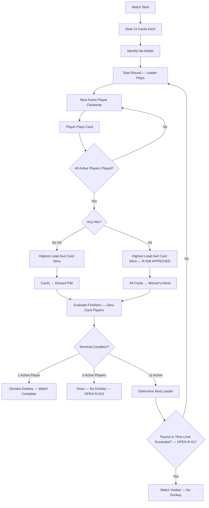

# 03 — Canonical Ruleset v1 Draft

**Document ID:** DM-RULES-1.0-DRAFT  
**Version:** 0.1 DRAFT — **NOT APPROVED FOR IMPLEMENTATION**  
**Date:** 2026-10-20  
**Status:** Awaiting owner sign-off on all OPEN items before this becomes DM-RULES-1.0

---

## Purpose

Define a complete, deterministic, implementable ruleset for the Donkey card game. Every legal move, resolution, edge case, and terminal condition is specified with enough precision to write a state machine and golden test fixtures. OPEN items present recommended options and alternatives — they are **not** resolved.

## Scope

Covers the full game lifecycle from deck composition through terminal result. Does not cover UI, animations, network transport, or economy — those are in sibling documents.

---

## BLOCKING OPEN DECISIONS

**Do not implement until these are resolved by owner approval.**

| ID | Decision | Recommended | Alternative(s) | See |
|---|---|---|---|---|
| R-002 | Shuffle policy | Uniform CSPRNG | ~~Suit-balanced heuristic; rejection sampling~~ | §2 — **OWNER APPROVED 2026-10-21** |
| R-003 | A♠ opening constraint | Any card | ~~Must play A♠~~ | §4 — **OWNER APPROVED 2026-10-21** |
| R-008 | Hit winner comparison | Leading-suit highest only | ~~Cross-suit highest rank~~ | §8 — **OWNER APPROVED 2026-10-21** |
| R-010 | Simultaneous finisher ranking | Clockwise deterministic | ~~Tied ranks~~ | §10 — **OWNER APPROVED 2026-10-21** |
| R-013 | All players empty | Draw / no Donkey | Replay; last-hit-recipient is Donkey | §12 |
| R-017 | Watchdog threshold | Void after 200 rounds (configurable) | No watchdog | §14 |

---

## 1. Deck Composition

**[CONFIRMED]**

- Standard 52-card deck.
- Four suits: Spades (♠), Hearts (♥), Diamonds (♦), Clubs (♣).
- Thirteen ranks per suit: 2, 3, 4, 5, 6, 7, 8, 9, 10, J, Q, K, A.
- No jokers, wildcards, or special cards.
- Each card is globally unique, identified by `(suit, rank)`.

### 1.1 Rank Ordering

**[CONFIRMED]**

Ascending: 2(2) < 3(3) < 4(4) < 5(5) < 6(6) < 7(7) < 8(8) < 9(9) < 10(10) < J(11) < Q(12) < K(13) < A(14).

Ace is always high. There is no low-Ace variant.

---

## 2. Shuffle and Deal

### 2.1 Shuffle

**[OWNER APPROVED — R-002 — 2026-10-21]**

Uniform random permutation (Fisher-Yates) using a cryptographically secure random number generator (CSPRNG) for production play. The server generates the shuffle for online matches; the local Dart engine generates the shuffle for offline matches. No suit-distribution skewing or balancing heuristic is applied.

**Test/simulation distinction:** Production shuffles use CSPRNG (not seedable for replay). Test fixtures and simulation harnesses use a seeded deterministic PRNG with a recorded seed for reproducibility. See [07-offline-online-parity-strategy.md](07-offline-online-parity-strategy.md) §6 for platform RNG handling.

> **Owner note (2026-10-21):** Uniform CSPRNG shuffle approved as the product owner's choice for our original game. The competitor reference mentions intentional non-uniform suit distribution, but the algorithm is proprietary and unpublished. We do not replicate or approximate it. Fair, simple, testable, original.

### Historical Alternatives Considered

**Alternative A (Rejected):** Replicate the competitor's undisclosed suit-skewing algorithm. Rejected because the algorithm is proprietary and unknown — implementing an unverified manipulation risks incorrect gameplay feel and potential fairness complaints.

**Alternative B (Rejected):** Disclosed balancing heuristic (e.g., guarantee each player gets ≥2 of each suit). Rejected in favor of uniform randomness — no invented bias, fully testable, no additional complexity.

### 2.2 Deal

**[CONFIRMED]**

- Exactly 4 players, each receives exactly 13 cards.
- 52 / 4 = 13; no remainder cards.
- Deal order: cards distributed one at a time in clockwise seat order (or equivalently, 13-card blocks — result is identical given uniform shuffle).
- After dealing, every card is in exactly one player's hand. No cards in discard or trick area.

### 2.3 Shuffle Seed Security

- **Online:** Server generates shuffle; seed is secret until match completion. Neither the seed nor the full deck order is sent to any client before or during the match.
- **Offline:** Local engine generates shuffle; seed may be stored for replay/debugging.

---

## 3. Players and Seats

**[CONFIRMED]**

- Exactly 4 players at match start. Seats are numbered 0–3 (or 1–4; implementation detail).
- Each seat is occupied by exactly one player (human or bot).
- Seat assignment is fixed for the duration of the match.
- Clockwise order: Seat 0 → 1 → 2 → 3 → 0 (wrapping).

---

## 4. Opening — First Round Leader

**[OWNER APPROVED — R-003 — 2026-10-21]**

The player holding the Ace of Spades (A♠) leads the first round. The A♠ holder may lead with **any** card from their hand. Playing A♠ is legal but not required.

> **Owner note (2026-10-21):** Free choice approved as the product owner's choice for our original game. "Starts" in the source text is naturally read as "goes first," not "must play a specific card." This gives the first player strategic choice.

### Historical Alternative Considered (Option B): Must play A♠

The A♠ holder **must** play A♠ as the first card. This would be the only forced-card rule in the game. Rejected — removes first-move agency without clear gameplay benefit.

---

## 5. Turn Order

**[PROPOSED]**

- Within a round, players act in **clockwise seat order** starting from the leader.
- **Finished players are skipped.** A player who has exited (zero cards, confirmed finisher) never acts.
- Turn advances only upon valid card play or server-executed timeout action.
- Exactly one player has the turn at any moment; no simultaneous play.

---

## 6. Follow-Suit Rule

**[CONFIRMED]**

When it is a player's turn:

1. **Leading:** The leader may play any card from their hand. The suit of this card becomes the **leading suit** for the round.
2. **Following:** Each subsequent player in the round **must** play a card of the leading suit if they hold one or more cards of that suit.
3. **Hit (void in suit):** If a player holds **zero** cards of the leading suit, they may play any card from their hand. This play is flagged as a **HIT**.

### 6.1 Legal Move Validation

For a player's turn with leading suit `S` established:

```
IF player.hand contains any card with suit == S:
    legalMoves = player.hand.filter(card => card.suit == S)
ELSE:
    legalMoves = player.hand  (all cards; this play is a HIT)
```

**Illegal moves are rejected** with no state change, no turn advance, and a clear error code. The player must resubmit a legal card.

---

## 7. No-Hit Round Resolution

**[PROPOSED]** (standard interpretation of confirmed source)

When all active players in the round have played and **no** play was flagged as a hit:

1. **Winner determination:** The player who played the **highest-rank card of the leading suit** wins the round.
2. **Card disposition:** All cards played in the round are moved to the **permanent discard pile**. They are removed from the game permanently.
3. **Next leader:** The winner leads the next round (subject to finisher replacement; see §11).

---

## 8. Hit Round Resolution

**[OWNER APPROVED — R-008 — 2026-10-21]**

When all active players in the round have played and **at least one** play was flagged as a hit:

1. **Winner determination:** The player who played the **highest-rank card of the leading suit** wins the round. Off-suit (hit) cards **do not participate** in winner comparison.
2. **Card disposition:** **All** cards played in the round (including off-suit hit cards) are added to the **winner's hand**.
3. **Next leader:** The winner leads the next round.

**Acceptance example (owner-provided):** Lead 8♣; players then play J♣, 10♣, A♥. The A♥ is a HIT; the J♣ seat wins and collects all four cards.

> **Owner note (2026-10-21):** "This is the product owner's choice for our original game, not independent proof that CodeHound uses it."

**Competitor behavior: NOT VERIFIED.** The competitor's published description says "largest card" without specifying cross-suit comparison. Their actual implementation behavior has not been independently verified. This rule is our product design, not a claim about the competitor.

### Historical Alternative Considered (Option B): Absolute highest rank wins

1. **Winner determination:** The player who played the **highest-rank card regardless of suit** wins. If tied (same rank, different suits), the leading-suit card wins ties.
2. Cards and leader as above.

**Example (Option B):** Lead 8♣ → J♣ → 10♣ → A♥. Winner = A♥ player (rank 14 > 11). A♥ player receives all 4 cards.

**Rationale for Option A:** Under Option A, hitting is always a penalty (you lose your card into someone else's hand). Under Option B, hitting with a high card is strategically viable. Option A was chosen by the product owner as the intended design for our original game.

---

## 9. Finisher Timing

**[OWNER APPROVED — R-009 — 2026-10-21]**

A player qualifies as a finisher **only after the entire round has resolved**, including any HIT collection and card transfers. An empty hand immediately after the last card is played does **not** by itself establish a finish.

1. All players play their cards for the round.
2. Hit/no-hit determination is made.
3. Cards are moved (to discard or to winner's hand).
4. **Then** evaluate which players now have zero cards.
5. If a player's hand remains empty after settlement, they qualify as a finisher and leave subsequent turns.
6. If they collected the HIT trick and acquired cards, they do **not** finish yet.

**Acceptance example (owner-provided, scenario 1):** A player holds only J♣, plays it, and a later player with no clubs plays A♥. Under R-008 the J♣ player wins the HIT and receives all trick cards. **They have not finished** under R-009 — their hand now contains collected cards.

**Acceptance example (scenario 2):** A player plays their last card; the round has no HIT and all played cards are discarded. The player's hand remains empty. **They qualify as a finisher** after round resolution.

**Acceptance example (scenario 3):** A player plays their last card as an off-suit HIT, while another player wins collection with the highest leading-suit card. After resolution, the hitting player's hand remains empty. **They qualify as a finisher**.

> **Owner note (2026-10-21):** R-009 is approved for our original game. Multiple same-round finishers are now ranked by R-010 (OWNER APPROVED 2026-10-21) — distinct positions in clockwise order from the round leader. If all active players empty in the same resolution, R-013 remains OPEN — do not infer the draw rule from R-009 or R-010 approval.

---

## 10. Simultaneous Finisher Ranking

**[OWNER APPROVED — R-010 — 2026-10-21]**

When two or more players become qualifying finishers as the result of the **same fully settled round**, assign **distinct, consecutive positions** in clockwise seat order starting **with the completed round's leader** (inclusive), considering only those who qualify in that resolution. Do not award tied ranks.

A **qualifying finisher** is a player whose hand is empty **after the entire round has resolved**, including HIT collection, as already approved in R-009.

### Deterministic Algorithm

1. After round resolution (R-008 for hit, §7 for no-hit) and card movement, identify all active players with zero cards.
2. Starting from the round leader's seat, traverse clockwise through all seats.
3. For each seat encountered that is a qualifying finisher in this round, assign the next available finishing position.
4. Non-finishers and already-finished players are skipped in the traversal.

### Acceptance Example (Owner-Provided)

Round leader = Seat 1. After settlement, Seats 2 and 0 both qualify as finishers. Clockwise traversal from leader: 1 → 2 → 3 → 0. Among the finishers, Seat 2 precedes Seat 0. If these are the first players ever to finish, Seat 2 ranks 1st (winner) and Seat 0 ranks 2nd.

### Rules Integration

Apply R-008 (HIT winner), then R-009 (finisher evaluation after settlement), then R-010 (position assignment). If an all-empty terminal situation occurs, handle it under R-013 which remains **OPEN** — this approval does not choose the all-empty match outcome or silently override R-013.

### Historical Alternative Considered (Option B): Tied ranks

All simultaneously finishing players share the same finishing position (e.g., two players tie for 1st; next finisher is 3rd).

**Rationale for Option A:** Clockwise deterministic ranking provides unambiguous, testable positions. Tied ranks complicate leaderboard display and competitive fairness perception. Option A was chosen by the product owner.

---

## 11. Leader Replacement After Finisher Exit

**[PROPOSED — R-011]**

If the round winner (who would normally lead next) has zero cards after resolution and becomes a finisher:

- The **next active player clockwise** from the exited winner becomes the leader for the next round.
- "Active" means the player has ≥1 card and has not been declared a finisher.

---

## 12. All Players Empty — Draw Condition

**[OPEN — R-013]**

If every remaining active player reaches zero cards in the same round resolution:

### Recommended (Option A): Draw / No Donkey

The match ends as a **technical draw**. No player is assigned the Donkey label. All finishing positions up to that point are retained. The final round's participants all share the next finishing position (or per §10 if clockwise ordering is approved).

### Alternative (Option B): Last hit recipient is Donkey

The player who most recently collected cards from a hit round is the Donkey. Others are ranked clockwise.

### Alternative (Option C): Replay

The match is voided and restarted. Original results discarded.

**Recommendation rationale:** Option A is the fairest — no invented loser. The probability of this scenario is extremely low in normal play (all four players would need to empty in one round from a state where all had exactly one card and no hit occurred).

---

## 13. Terminal Condition — Donkey Declaration

**[CONFIRMED objective; PROPOSED trigger — R-012]**

### WIN-001: Game Objective — CONFIRMED PRODUCT OBJECTIVE (2026-10-21)

**The first qualifying finisher takes first place and is the game winner. The last player still holding cards is the Donkey.**

A qualifying finisher is a player whose hand remains empty after full round resolution (R-009 APPROVED). A HIT-round trick winner (who collects cards per R-008) is **not** necessarily the game winner — collecting trick cards means they have not finished.

> **Owner note (2026-10-21):** WIN-001 is confirmed. R-009 (finisher timing) is OWNER APPROVED — "successfully" means empty after round settlement including HIT collection. R-010 (simultaneous finisher ranking) is OWNER APPROVED — multiple same-round finishers receive distinct positions in clockwise order from the round leader. If all active players empty simultaneously, the outcome is still **OPEN** (R-013/D06). R-013 is not automatically approved by WIN-001, R-009, or R-010.

### Donkey Declaration

The match ends when exactly **one active player remains with cards** after a round is fully resolved.

1. After round resolution and finisher evaluation:
2. Count active players (those with ≥1 card who are not finishers).
3. If exactly 1 active player remains → that player is the **Donkey**.
4. If 0 active players remain → draw condition (§12).
5. If ≥2 active players remain → game continues; next leader per §11.

**Match result:**
- Positions 1st, 2nd, 3rd assigned to finishers in order of exit.
- The Donkey receives the last position (4th in standard 4-player).
- Result is committed exactly once and is immutable.

---

## 14. Watchdog — Pathological Match Void

**[OPEN — R-017]**

### Recommended

If a match exceeds a configurable round limit (proposed: **200 rounds**) or a configurable wall-clock duration (proposed: **30 minutes** from match start), the match is **voided**:

- No Donkey is assigned.
- No competitive outcome is recorded.
- No rewards or penalties are granted.
- A diagnostic log with the match seed and event journal is preserved for analysis.
- The match transitions to the `VOIDED` terminal state (see [04-game-state-machine.md](04-game-state-machine.md) §1.1).

The watchdog must **never** assign an arbitrary Donkey or fabricate a winner. A voided match records no competitive outcome, no rewards, and no penalties for any player.

### Alternative

No watchdog; trust that the game always terminates naturally. Risk: a bug or edge case could create an infinite loop, locking four players and consuming server resources.

---

## 15. Timeout and Inactivity

**[PROPOSED]**

| Parameter | Proposed Value | Notes |
|---|---|---|
| Action deadline | 20 seconds | Time for current player to submit a legal card |
| Disconnect grace | 15 seconds | Time before bot takeover on connection loss |
| Bot takeover | Automatic | Server selects a legal move using the seat's bot policy |
| Reclaim window | Next round boundary | Reconnecting player regains control at start of next round |

### 15.1 Timeout Resolution

1. Player's action deadline expires without a valid card play.
2. Server generates an audit event: `TimeoutAutoPlay`.
3. Server selects a legal card using the bot policy for the seat (random legal for Easy; heuristic for Normal).
4. Card is played as if the player submitted it. All resolution rules apply normally.
5. All players are notified of the timeout and auto-play.

### 15.2 Disconnect Resolution

1. Player's WebSocket disconnects.
2. Server starts disconnect grace timer (15 seconds).
3. If player reconnects within grace: resume normal play; player receives authoritative snapshot.
4. If grace expires: seat transitions to `BOT_CONTROLLED`. Server plays on behalf of the player.
5. Bot-controlled seat is disclosed to all players.
6. If player reconnects later: `RECLAIM_PENDING` state; control returns at next round boundary.

### 15.3 Abandonment

If a player's seat remains bot-controlled for the remainder of the match, the match continues to completion. The bot-controlled seat can still finish or become Donkey. Results are recorded normally with a flag indicating bot takeover.

---

## 16. Bot Behavior

**[PROPOSED]**

### 16.1 Information Constraint

Bots operate with the **same information** available to a human player in the same seat:

- Own hand
- Cards played in the current round (visible to all)
- Lead suit
- Number of cards in each opponent's hand (visible count)
- History of played cards (public information)

Bots may **not** access:
- Opponent hand contents
- Deck order or shuffle seed
- Other bots' decision functions

### 16.2 Difficulty Levels

| Level | Policy |
|---|---|
| Easy | Random legal move (seeded RNG; not CSPRNG) |
| Normal | Rank conservation heuristic: prefer low-rank cards when following suit; avoid hitting when possible; estimate hit probability from visible card history |

### 16.3 Disclosure

Bot-controlled seats are **always labeled** in the UI. Match results indicate which seats were bot-controlled and for how long.

---

## 17. State Invariants

The following must hold at every point in the match lifecycle:

| # | Invariant |
|---|---|
| INV-1 | Exactly 52 distinct cards are partitioned among: player hands, current trick (cards played this round), and permanent discard pile. No card is missing, duplicated, or unaccounted for. |
| INV-2 | In a hit round, all trick cards move to exactly one winner's hand. No discards in hit rounds. |
| INV-3 | In a no-hit round, all trick cards move to the permanent discard pile. No cards go to any hand. |
| INV-4 | The current turn belongs to an active player (has cards, not a finisher). Never a finished player's turn. |
| INV-5 | No opponent hand contents are visible to any other player during the match (except cards legally played). |
| INV-6 | Match version is monotonically increasing. Exactly one event advances the match at a time. |
| INV-7 | Finish order is stable and append-only. No player re-enters active play after confirmed exit. |
| INV-8 | Terminal result is committed at most once and is immutable after commit. |
| INV-9 | All validations precede mutations. A rejected action produces zero state change. |
| INV-10 | Rewards/outcomes are never derived from client-submitted data. |

---

## 18. Reference Test Fixtures

These fixtures define expected behavior for golden tests. Both Dart and C# engines must produce identical results.

**52-card conservation invariant (INV-1):** Every full-game fixture must account for all 52 distinct cards across player hands, current trick, and discard pile at every state checkpoint. Fixture validation tooling must assert this invariant before the fixture is accepted into the suite.

### Fixture 1: No-Hit Round

```
Setup:
  Active players: [S0, S1, S2, S3]
  Leader: S0

Plays:
  S0: 8♣ (leads clubs)
  S1: 10♣ (follows suit)
  S2: Q♣ (follows suit)
  S3: 2♣ (follows suit)

Resolution:
  Hit: false
  Winner: S2 (Q♣, rank 12 — highest club)
  Card disposition: All 4 cards → discard pile
  Next leader: S2
  Hand changes: S0 -1, S1 -1, S2 -1, S3 -1
  Discard +4
```

### Fixture 2: Hit Round (Recommended Option A — leading suit wins)

```
Setup:
  Active players: [S0, S1, S2, S3]
  Leader: S0

Plays:
  S0: 8♣ (leads clubs)
  S1: J♣ (follows suit)
  S2: 10♣ (follows suit)
  S3: 2♥ (no clubs → HIT)

Resolution:
  Hit: true
  Winner: S1 (J♣, rank 11 — highest club)
  Card disposition: All 4 cards → S1's hand
  Next leader: S1
  Hand changes: S0 -1, S1 +3, S2 -1, S3 -1
  Discard: no change
```

### Fixture 3: Off-Suit Higher Rank in Hit (validates R-008 — OWNER APPROVED)

```
Setup:
  Active players: [S0, S1, S2, S3]
  Leader: S0

Plays:
  S0: 8♣ (leads clubs)
  S1: J♣ (follows suit)
  S2: 10♣ (follows suit)
  S3: A♥ (no clubs → HIT, rank 14)

Resolution (APPROVED — leading-suit highest wins):
  Hit: true
  Winner: S1 (J♣, rank 11 — highest CLUB, not A♥)
  Card disposition: All 4 cards → S1's hand

Historical alternative considered (Option B — rejected):
  Winner: S3 (A♥, rank 14 — absolute highest)
  Card disposition: All 4 cards → S3's hand

R-008 approved by owner 2026-10-21. This fixture uses the approved resolution.
```

### Fixture 4: Follow-Suit Enforcement (Illegal Move Rejection)

```
Setup:
  Leader S0 has played 8♣. It is S1's turn.
  S1's hand includes: [3♣, A♥, K♦, 7♠]

Legal moves: [3♣] (only club in hand)
Illegal moves: [A♥, K♦, 7♠]

Action: S1 attempts to play A♥
Result: REJECTED — player holds clubs; must follow suit
State: UNCHANGED — no card removed, no turn advance
```

### Fixture 5: Finisher After Round Resolution — Off-Suit HIT Qualifies (R-009 APPROVED)

```
Setup:
  Active players: [S0, S1, S2, S3]
  Leader: S0
  S3's hand: [2♥] (last card)

Plays:
  S0: 8♣ (leads clubs)
  S1: J♣ (follows suit)
  S2: 10♣ (follows suit)
  S3: 2♥ (no clubs → HIT, last card played)

Resolution (R-008 + R-009 APPROVED):
  Hit: true
  Winner: S1 (J♣ — highest club, per R-008)
  Cards → S1's hand
  
  Post-resolution finisher evaluation (R-009):
    S3 hand size: 0 → S3 is a FINISHER (played off-suit HIT; another player collected)
    S0 hand size: decreased by 1 → still active (if > 0)
    S1 hand size: increased by 3 → still active (HIT winner collected cards, NOT a finisher)
    S2 hand size: decreased by 1 → still active (if > 0)

  Owner golden scenario 3: player plays last card as off-suit HIT,
  another player wins collection → hitting player qualifies as finisher.
```

### Fixture 5a: Leading-Suit Winner Plays Last Card but Collects HIT (R-009 APPROVED)

```
Setup:
  Active players: [S0, S1, S2, S3]
  Leader: S0
  S1's hand: [J♣] (last card)

Plays:
  S0: 8♣ (leads clubs)
  S1: J♣ (follows suit — last card played)
  S2: 10♣ (follows suit)
  S3: A♥ (no clubs → HIT)

Resolution (R-008 + R-009 APPROVED):
  Hit: true
  Winner: S1 (J♣ — highest club, per R-008)
  Cards → S1's hand (S1 receives all 4 cards)

  Post-resolution finisher evaluation (R-009):
    S1 hand size: 3 (played 1, received 4) → NOT a finisher
    S1 played their last card but then received HIT collection → still active.

  Owner golden scenario 1: player plays last card, wins the HIT,
  collects trick cards → they have NOT finished.
```

### Fixture 6: No-Hit Round — Player Plays Last Card and Qualifies (R-009 APPROVED)

```
Setup:
  Active players: [S0, S1, S2, S3]
  Leader: S0
  S2's hand: [Q♣] (last card)

Plays:
  S0: 8♣
  S1: 10♣
  S2: Q♣ (last card, follows suit)
  S3: 2♣

Resolution:
  Hit: false
  Winner: S2 (Q♣ — highest club)
  Cards → discard

  Post-resolution finisher evaluation (R-009):
    S2 hand size: 0 → S2 is FINISHER (no HIT, cards discarded, hand remains empty)
    S2 was the winner → would normally lead next
    Leader replacement: next active seat clockwise from S2 → S3 (if active)

  Owner golden scenario 2: player plays last card; no HIT; all cards discarded;
  hand remains empty → qualifies as finisher after round resolution.
```

### Fixture 6a: Two Simultaneous Finishers — Clockwise Ranking (R-010 APPROVED)

```
Setup:
  Active players: [S0, S1, S2, S3]
  Leader: S1
  S0 finished earlier (1st place)
  S2's hand: [10♣] (last card)
  S3's hand: [2♣] (last card)

Plays:
  S1: 8♣ (leads clubs)
  S2: 10♣ (follows suit — last card)
  S3: 2♣ (follows suit — last card)

Resolution:
  Hit: false
  Winner: S2 (10♣ — highest club)
  Cards → discard

  Post-resolution finisher evaluation (R-009):
    S2 hand size: 0 → qualifying finisher
    S3 hand size: 0 → qualifying finisher
    S1 hand size: decreased by 1 → still active (if > 0)

  Simultaneous finisher ranking (R-010 APPROVED):
    Round leader = S1. Clockwise traversal: S1 → S2 → S3 → S0.
    Among qualifying finishers: S2 comes before S3.
    S2 → 2nd place; S3 → 3rd place.
    S1 is last active player → DONKEY (4th place).

Final result:
  1st: S0 (finished earlier)
  2nd: S2
  3rd: S3
  4th (Donkey): S1
```

### Fixture 6b: Two Simultaneous Finishers — Different Leader Seat (R-010 APPROVED)

```
Setup:
  Active players: [S0, S1, S2, S3]
  Leader: S3
  S2's hand: [Q♦] (last card)
  S0's hand: [5♦] (last card)

Plays:
  S3: 9♦ (leads diamonds)
  S0: 5♦ (follows suit — last card)
  S1: K♦ (follows suit)
  S2: Q♦ (follows suit — last card)

Resolution:
  Hit: false
  Winner: S1 (K♦ — highest diamond)
  Cards → discard

  Post-resolution finisher evaluation (R-009):
    S0 hand size: 0 → qualifying finisher
    S2 hand size: 0 → qualifying finisher

  Simultaneous finisher ranking (R-010 APPROVED):
    Round leader = S3. Clockwise: S3 → S0 → S1 → S2.
    Among qualifying finishers: S0 precedes S2.
    S0 → 1st place (winner); S2 → 2nd place.

Note: Leader seat changes the ranking order. With S1 as leader,
S2 would precede S0 instead.
```

### Fixture 6c: HIT Prevents Finish — Not a Simultaneous Finisher (R-009 + R-010)

```
Setup:
  Active players: [S0, S1, S2, S3]
  Leader: S0
  S1's hand: [J♣] (last card)
  S3's hand: [A♥] (last card)

Plays:
  S0: 8♣ (leads clubs)
  S1: J♣ (follows suit — last card)
  S2: 10♣ (follows suit)
  S3: A♥ (no clubs → HIT — last card)

Resolution (R-008 + R-009):
  Hit: true
  Winner: S1 (J♣ — highest club, per R-008)
  Cards → S1's hand

  Post-resolution finisher evaluation (R-009):
    S1 hand size: 3 (played 1, received 4) → NOT a finisher
    S3 hand size: 0 (played off-suit HIT; another player collected) → FINISHER

  R-010 does not apply: only one qualifying finisher in this round.
  S3 receives the next finishing position.

Key: S1 played their last card but HIT collection prevents
qualification. Only S3 qualifies despite both playing last cards.
```

### Fixture 7: Two Active Seats

```
Setup:
  Active players: [S1, S3] (S0 and S2 are finishers)
  Leader: S1

Plays:
  S1: K♦ (leads diamonds)
  S3: 5♦ (follows suit)

Resolution:
  Hit: false
  Winner: S1 (K♦)
  Cards → discard
  Next leader: S1
  
  (S0 and S2 are skipped entirely)
```

### Fixture 8: All Hands Emptied (Draw)

```
Setup:
  Active players: [S1, S3] (S0 and S2 are finishers)
  S1's hand: [7♠]
  S3's hand: [3♠]
  Leader: S1

Plays:
  S1: 7♠ (leads spades, last card)
  S3: 3♠ (follows suit, last card)

Resolution:
  Hit: false
  Winner: S1 (7♠)
  Cards → discard

  Post-resolution:
    S1 hand: 0 → finisher
    S3 hand: 0 → finisher
    Active players: 0
    Result (Option A — recommended): DRAW / NO DONKEY
```

### Fixture 9: Duplicate Action (Idempotency)

```
Action 1: PlayCard(matchId=M1, cardId=8♣, expectedVersion=5, actionId=UUID-A)
Result 1: ACCEPTED — card played, version → 6

Action 2: PlayCard(matchId=M1, cardId=8♣, expectedVersion=5, actionId=UUID-A)  [DUPLICATE]
Result 2: Return previously committed acknowledgement for UUID-A
State: UNCHANGED from after Action 1
```

### Fixture 10: Terminal — Donkey Declaration

```
Setup:
  Active players: [S1, S3] (S0 finished 1st, S2 finished 2nd)
  S1's hand: [K♥]
  S3's hand: [4♥, 7♦, J♠]
  Leader: S1

Plays:
  S1: K♥ (leads hearts, last card)
  S3: 4♥ (follows suit)

Resolution:
  Hit: false
  Winner: S1 (K♥)
  Cards → discard

  Post-resolution:
    S1 hand: 0 → S1 is FINISHER (3rd place)
    S3 hand: [7♦, J♠] — still has cards
    Active players: 1 (S3 only)
    
    Terminal condition: exactly 1 active player → S3 is DONKEY (4th place)

Final result:
  1st: S0
  2nd: S2
  3rd: S1
  4th (Donkey): S3
```

---

## 19. Game Flow Summary (Mermaid)



---

## Acceptance Criteria for This Document

- [ ] Every rule is classified as CONFIRMED, PROPOSED, or OPEN
- [ ] All OPEN items present recommended option plus at least one alternative
- [ ] No ambiguity is silently resolved
- [ ] Test fixtures cover all major resolution paths
- [x] Fixtures include the critical R-008 off-suit comparison case (owner approved 2026-10-21; Option A locked)
- [ ] State invariants are complete and testable
- [ ] Document is sufficient for two independent engineers to implement identical state machines

---

## Cross-References

| Document | Relationship |
|---|---|
| [02-verified-rules-and-open-questions.md](02-verified-rules-and-open-questions.md) | Evidence analysis backing these rules |
| [04-game-state-machine.md](04-game-state-machine.md) | State machine implementing this ruleset |
| [07-offline-online-parity-strategy.md](07-offline-online-parity-strategy.md) | Cross-language parity using these fixtures |
| [10-qa-test-matrix-and-acceptance.md](10-qa-test-matrix-and-acceptance.md) | Full test matrix derived from these rules |
| [12-risks-and-decisions.md](12-risks-and-decisions.md) | Decision register for OPEN items |
| [DONKEY_PHASE1_OWNER_RULE_DECISION_2026-10-21.md](DONKEY_PHASE1_OWNER_RULE_DECISION_2026-10-21.md) | Formal owner decision record for R-002, R-008, R-009, R-010 and WIN-001 |
| [REMAINING_DECISIONS_WORKSHEET.md](REMAINING_DECISIONS_WORKSHEET.md) | Per-item sign-off worksheet for all pending decisions |
| `RULE_FREEZE_APPROVAL_CHECKLIST.md` | Owner sign-off checklist |
