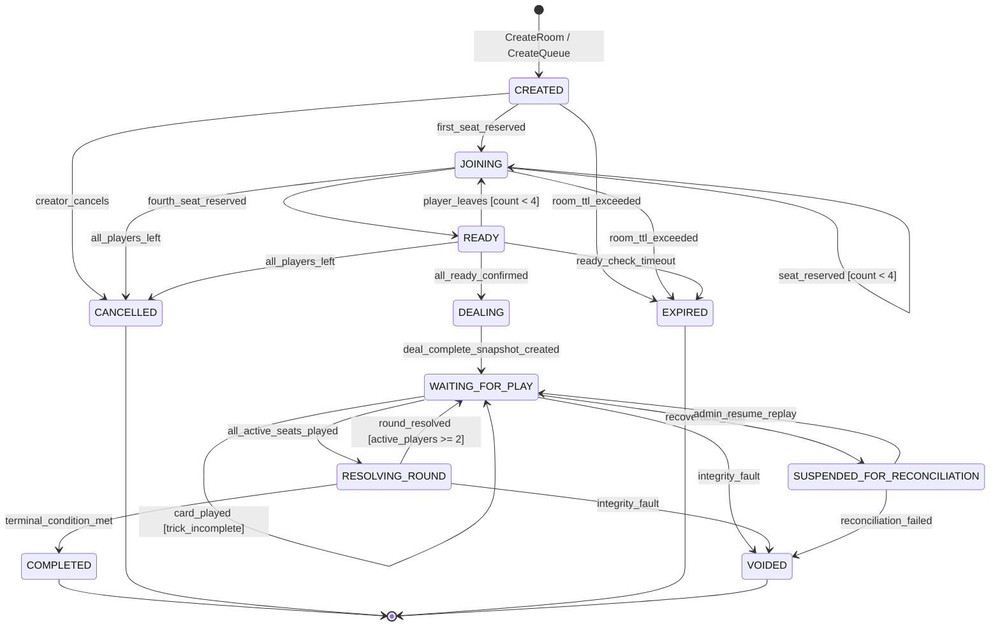
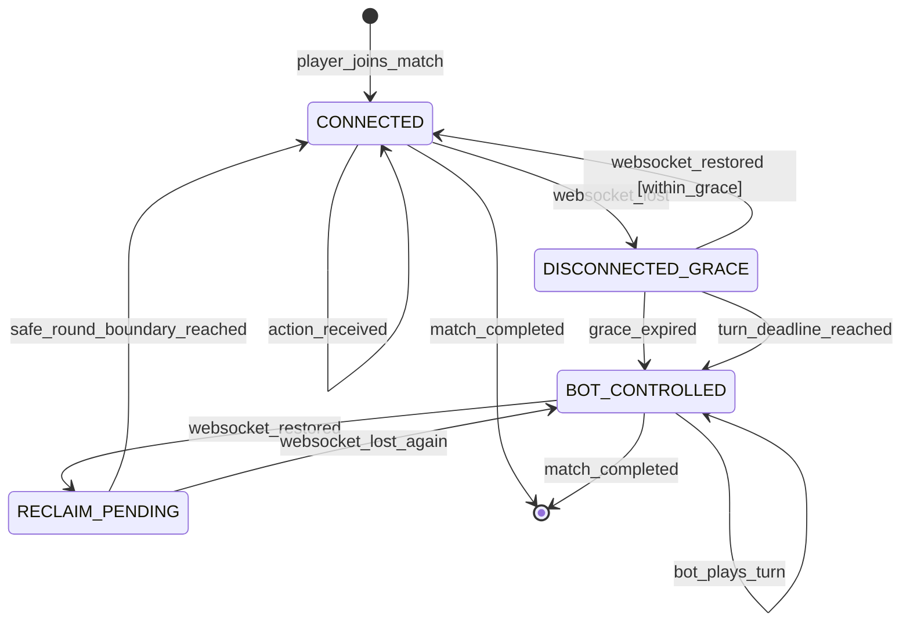
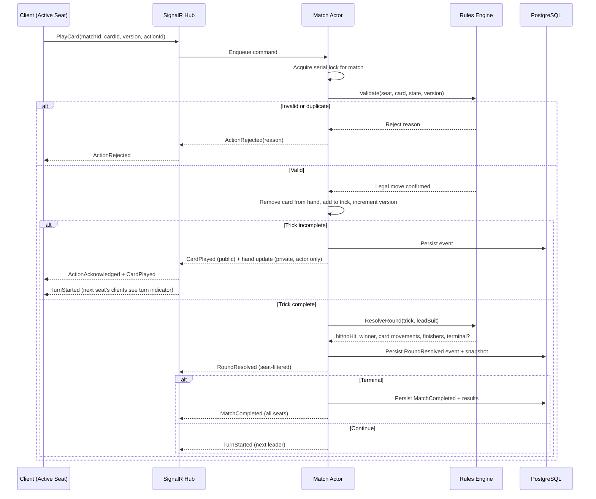
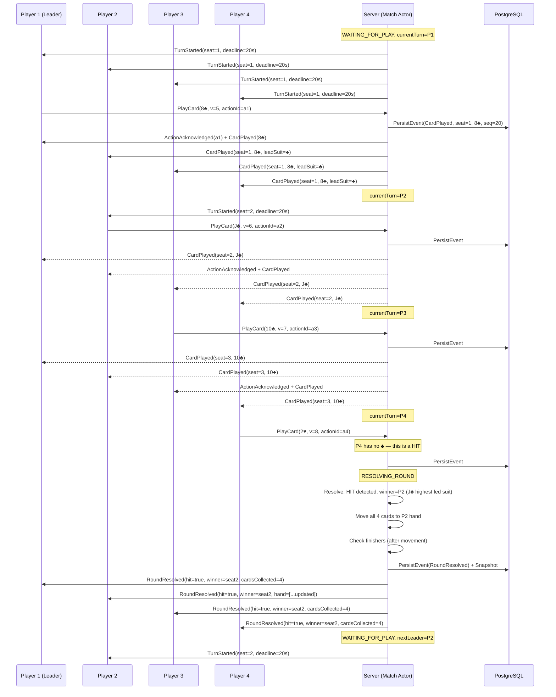
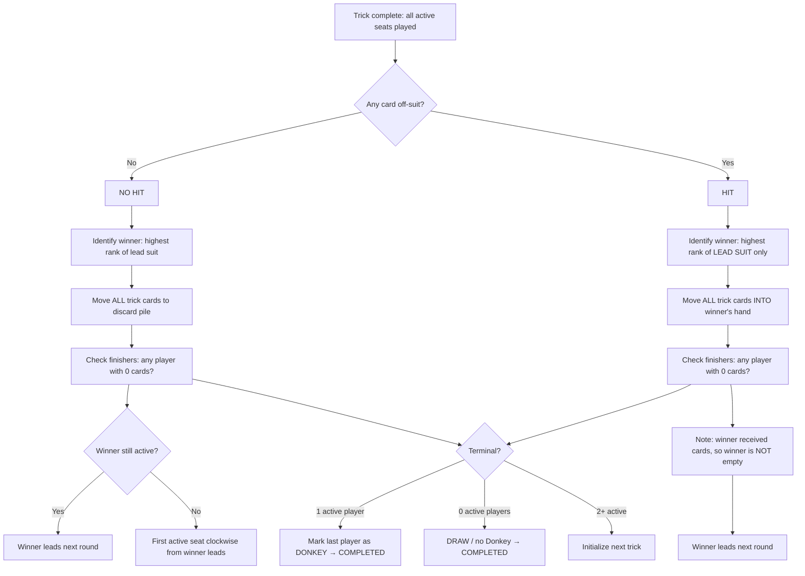
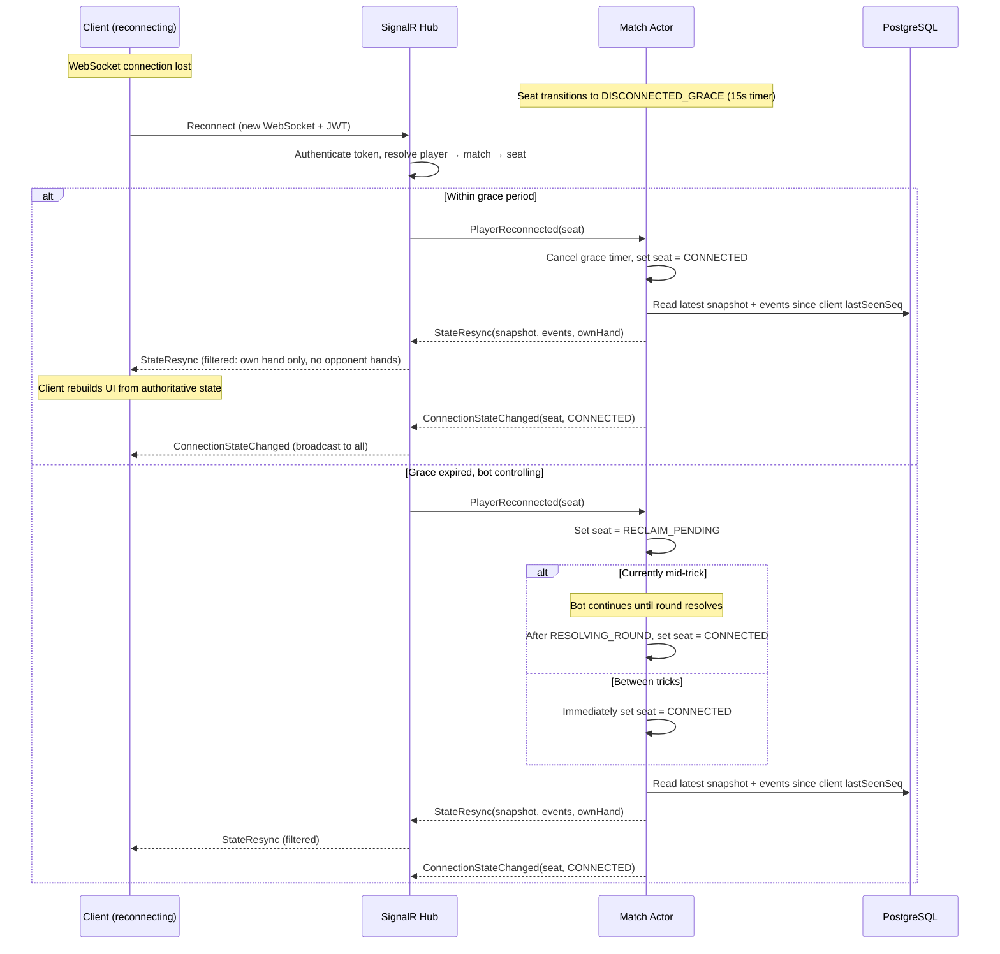
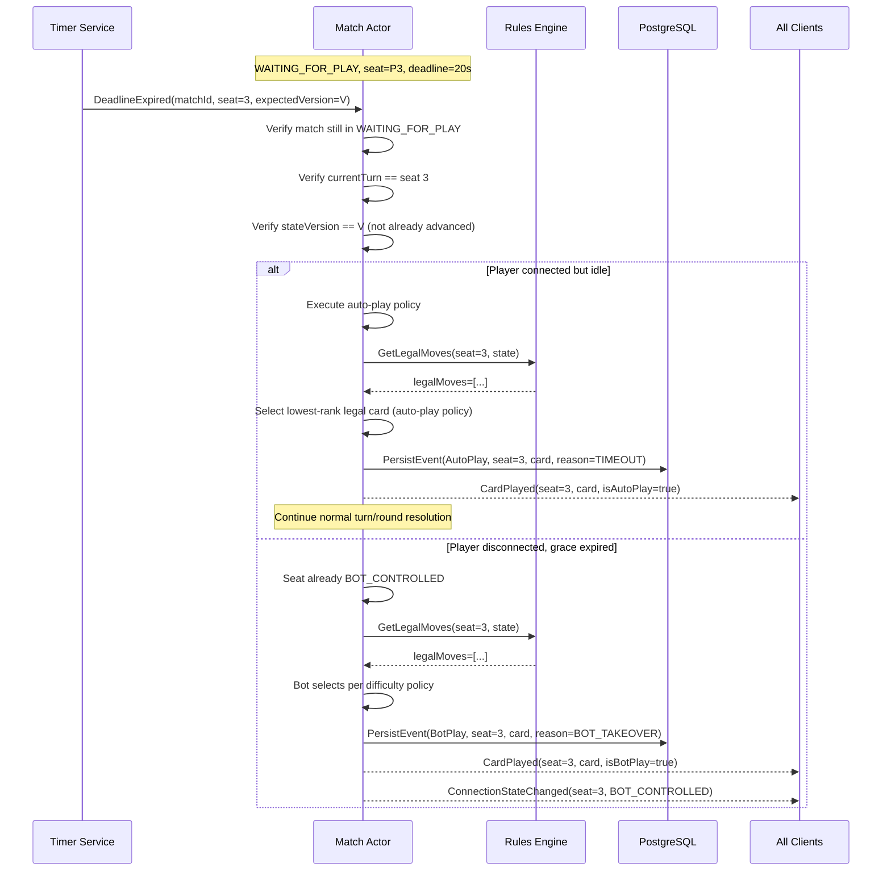
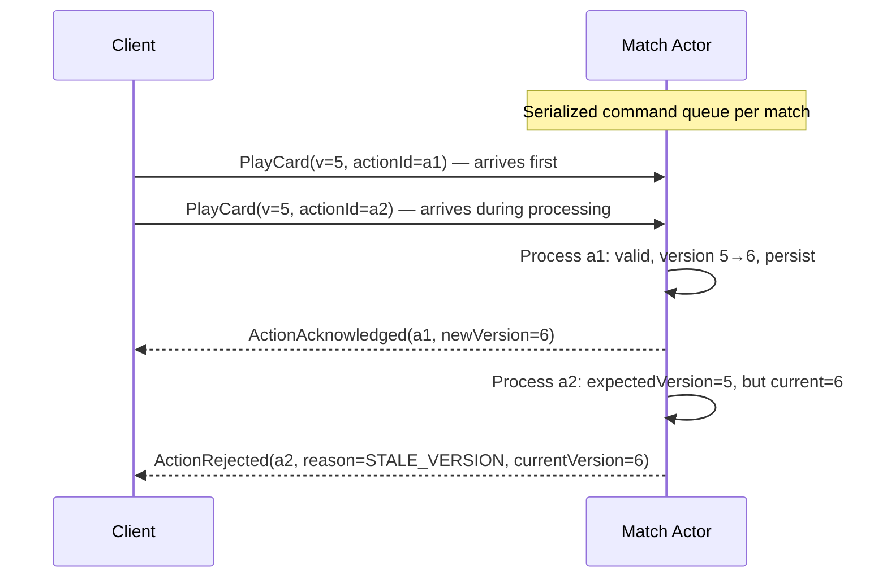

# 04 — Game State Machine

**Document ID:** DM-SM-004
**Version:** 0.1 DRAFT — not approved
**Date:** 2026-10-20
**Status:** Phase 1 specification only. No implementation code.

## Purpose

Define every state, transition, guard condition, and side-effect for the Donkey match lifecycle, per-seat connection lifecycle, and turn/round resolution. Provide Mermaid diagrams suitable for direct implementation reference and exhaustive test coverage.

## Scope

- Match lifecycle from lobby creation to terminal outcome.
- Per-seat connection orthogonal state machine.
- Turn resolution behavioral pseudocode and sequence diagrams.
- Online and offline round flows, hit/no-hit collection, reconnect, timeout/bot-takeover, and worker failover.
- Simultaneous and duplicate command handling.

---

## 1. Match Lifecycle State Machine

### 1.1 States

| State | Description | Allowed actions |
|---|---|---|
| `CREATED` | Lobby allocated, ruleset version locked, capacity = 4. | Join seat, cancel room. |
| `JOINING` | Seats being filled; identity/rate-limit validation on each join. | Join, leave, cancel. |
| `READY` | All 4 seats occupied; public auto-ready or private ready-check in progress. | Ready toggle (private), leave, cancel, timeout→expire. |
| `DEALING` | Server generates CSPRNG shuffle, deals 13 cards each, identifies A♠ holder, creates initial snapshot. | None (server-internal transition). |
| `WAITING_FOR_PLAY` | Active seat's turn; only that seat may issue `PlayCard` before deadline. | PlayCard, timeout, disconnect. |
| `RESOLVING_ROUND` | All active seats have played; deterministic hit/no-hit resolution in progress. | None (server-internal atomic transition). |
| `COMPLETED` | Terminal results committed, ledger processed idempotently. | VoteRematch, leave. |
| `CANCELLED` | Room cancelled before match started (e.g., all players left private room). | None (terminal). |
| `EXPIRED` | Unstarted room TTL exceeded. | None (terminal). |
| `VOIDED` | Irrecoverable integrity fault; no competitive outcome recorded. | None (terminal). |
| `SUSPENDED_FOR_RECONCILIATION` | Recoverable persistent-state problem; read-only until replay/resume. | Admin resume, void. |

### 1.2 Mermaid State Diagram — Match Lifecycle



### 1.3 Terminal Conditions

**WIN-001 (CONFIRMED 2026-10-21):** The first qualifying finisher (empty hand after full round settlement per R-009, OWNER APPROVED 2026-10-21) takes first place and is the game winner. The last player still holding cards is the Donkey. Simultaneous finisher ranking is now resolved by R-010 (OWNER APPROVED 2026-10-21): distinct consecutive positions in clockwise seat order from the round leader; no tied ranks. All-empty draw (R-013) is not automatically approved by WIN-001, R-009, or R-010.

A match reaches `COMPLETED` when any of:
- **Single Donkey:** After round resolution, exactly one active player holds cards. That player is the Donkey (R-012).
- **All Empty (OPEN R-013):** After round resolution, zero active players hold cards. Proposed: draw/no-Donkey.
- **Watchdog (OPEN R-017):** Round count exceeds configurable threshold (proposed: 200 rounds) or match wall-clock duration exceeds configurable limit (proposed: 30 minutes). Proposed: void/cancel, never assign arbitrary Donkey.

A match reaches `VOIDED` when:
- Unrecoverable state corruption detected (checksum mismatch, impossible card distribution).
- Watchdog triggers if voiding is the chosen policy.
- No competitive outcome or reward/penalty is recorded.

---

## 2. Per-Seat Connection State Machine

Connection state is **orthogonal** to match state — connection changes never mutate hand ownership, game phase, or card locations.

### 2.1 States

| State | Description |
|---|---|
| `CONNECTED` | Player's WebSocket is active; player controls their seat. |
| `DISCONNECTED_GRACE` | WebSocket lost; grace countdown running (proposed 15s). |
| `BOT_CONTROLLED` | Grace expired or player timed out; server bot plays legal moves on behalf. |
| `RECLAIM_PENDING` | Player reconnected; waiting for safe round boundary to restore control. |

### 2.2 Mermaid State Diagram — Seat Connection



### 2.3 Rules

- A disconnected player's hand remains intact and secret; the bot uses the same `GetLegalMoves` validator.
- Bot takeover is disclosed to all participants via `ConnectionStateChanged` event.
- Reclaim happens at next round boundary (after `RESOLVING_ROUND` completes), never mid-trick.
- If a player reconnects during `RESOLVING_ROUND`, they transition to `RECLAIM_PENDING` and regain control at the start of the next `WAITING_FOR_PLAY`.
- Private room host may configure stricter disconnect policy before match start.

---

## 3. Turn Resolution

### 3.1 Behavioral Pseudocode

This is specification pseudocode, NOT production code. Every step maps to a testable assertion.

```
FUNCTION ResolveTurn(command: PlayCard):
    // Step 1: Receive
    input = command(matchId, cardId, expectedStateVersion, actionId)

    // Step 2: Validate
    ASSERT player is authenticated
    ASSERT player owns seat in match
    ASSERT match.state == WAITING_FOR_PLAY
    ASSERT match.currentTurn == player.seat
    ASSERT match.stateVersion == expectedStateVersion
    ASSERT deadline not exceeded
    ASSERT cardId IN player.hand
    ASSERT cardId is legal:
        IF trick has a lead suit AND player holds >= 1 card of lead suit:
            ASSERT card.suit == lead suit
        ELSE:
            any card is legal (this play IS a HIT)

    // Step 3: Idempotency
    IF actionId already committed:
        RETURN previous acknowledgement (no state change)

    // Step 4: Atomic card movement
    REMOVE cardId FROM player.hand
    APPEND cardId TO currentTrick
    INCREMENT match.stateVersion

    // Step 5: Check trick completion
    IF currentTrick.count < activePlayerCount:
        ADVANCE currentTurn to next active seat (clockwise)
        SET new deadline
        BROADCAST public CardPlayed event (card face visible to all)
        SEND private hand update to actor only
        RETURN

    // Step 6: Determine round outcome
    hitDetected = ANY card in trick WHERE card.suit != leadSuit
    leadSuitCards = cards in trick WHERE card.suit == leadSuit
    winner = player of MAX(leadSuitCards, by rank) // R-008: only leading suit competes

    // Step 7: Card movement
    IF hitDetected:
        MOVE ALL trick cards INTO winner.hand
    ELSE:
        MOVE ALL trick cards INTO discardPile

    // Step 8: Determine finishers (AFTER card movement per R-009)
    // Clockwise order from round leader per R-010 (OWNER APPROVED 2026-10-21)
    newFinishers = []
    FOR EACH active player in clockwise order from round leader:
        IF player.hand.count == 0:
            APPEND player TO newFinishers
            ASSIGN next available finishing rank (distinct, consecutive per R-010)

    // Step 9: Check terminal condition
    activePlayers = players NOT finished
    IF activePlayers.count == 1:
        MARK activePlayers[0] as DONKEY
        SET match.state = COMPLETED
        COMMIT terminal result (once, immutable)
    ELSE IF activePlayers.count == 0:
        SET match.state = COMPLETED (DRAW, no Donkey) // R-013 OPEN
        COMMIT terminal result
    ELSE IF roundCount > WATCHDOG_ROUND_LIMIT OR elapsed > WATCHDOG_TIME_LIMIT:
        SET match.state = VOIDED // R-017 OPEN — proposed: 200 rounds or 30 min
    ELSE:
        // Determine next leader
        IF winner is still active:
            nextLeader = winner
        ELSE:
            nextLeader = first active seat clockwise from winner // R-011
        INITIALIZE next trick
        SET currentTurn = nextLeader
        SET new deadline

    // Step 10: Persist and broadcast
    COMMIT event to durable match log
    BROADCAST seat-filtered event views (no opponent hand data)
```

### 3.2 Turn Resolution Sequence Diagram



---

## 4. Online Round Sequence Diagram



---

## 5. Offline Round Sequence Diagram

```mermaid
sequenceDiagram
    participant UI as Flutter UI
    participant GE as Dart Rules Engine
    participant BOT as Bot Engine
    participant LS as Local Storage

    Note over GE: WAITING_FOR_PLAY, currentTurn=Human (seat 0)
    GE->>UI: TurnState(legalCards=[3♣, 7♣, K♣], leadSuit=♣)
    UI->>UI: Player selects K♣
    UI->>GE: PlayCard(K♣)
    GE->>GE: Validate(legal=true), remove from hand, add to trick

    Note over GE: currentTurn=Bot1 (seat 1)
    GE->>BOT: GetLegalMoves(seat=1, state)
    BOT->>BOT: Select move per difficulty policy (information-restricted)
    BOT-->>GE: PlayCard(5♣)
    GE->>GE: Validate, remove, add to trick

    Note over GE: currentTurn=Bot2 (seat 2)
    GE->>BOT: GetLegalMoves(seat=2, state)
    BOT-->>GE: PlayCard(A♥)
    Note over GE: Bot2 has no ♣ — HIT

    Note over GE: currentTurn=Bot3 (seat 3)
    GE->>BOT: GetLegalMoves(seat=3, state)
    BOT-->>GE: PlayCard(9♣)

    Note over GE: RESOLVING_ROUND
    GE->>GE: HIT detected; winner=Human (K♣ highest led suit)
    GE->>GE: All 4 cards → Human hand
    GE->>GE: Check finishers after movement
    GE->>LS: Save checkpoint state
    GE->>UI: RoundResult(hit=true, winner=seat0, newHand=[...])
    UI->>UI: Animate card collection to human hand
```

---

## 6. Hit Collection Flow



### 6.1 Finisher Determination Detail

After card movement (hit collection or discard), finisher evaluation proceeds:

1. Scan active players in **clockwise order starting from the round leader**.
2. Any player with zero cards is marked as a finisher and assigned the next sequential rank.
3. If multiple players reach zero in the same round, they finish in clockwise seat order from the round leader and receive distinct consecutive positions (R-010, OWNER APPROVED 2026-10-21 — no tied ranks).
4. A player who played their last card off-suit (causing a hit) but the hit winner is a different player: the off-suit player's hand is now empty. They finish (unless the hit winner was them, which is impossible since they played off-suit and only lead-suit wins).
5. The hit winner always receives cards, so the hit winner never finishes in the same round as the hit.

---

## 7. Reconnect Flow



### 7.1 Reconnect Rules

- Client sends `JoinMatch(matchId, lastSeenSeq)` on reconnection.
- Server returns authoritative snapshot + all events after `lastSeenSeq`.
- Response is **seat-filtered**: only the reconnecting player's own hand is included; opponent card counts may be shown but not card identities.
- If the client's `lastSeenSeq` is too old (compaction has removed those events), server sends a full snapshot instead.
- The client must **not** trust any locally cached state that conflicts with the server snapshot.
- Network retry always reuses the original `actionId` for any pending play.

---

## 8. Timeout and Bot-Takeover Flow



### 8.1 Timeout Policy (Proposed)

| Parameter | Value | Notes |
|---|---|---|
| Turn deadline | 20 seconds | Server clock only; device clocks never adjudicate. |
| Disconnection grace | 15 seconds | Before bot takeover begins. |
| Auto-play for connected timeout | Lowest legal card | Minimizes strategic advantage of timing out. |
| Bot policy for disconnected | Per difficulty setting | Easy=random legal, Normal=strategic but info-restricted. |
| Consecutive timeouts before penalty | 3 | After 3 consecutive timeouts from same connected player, consider abandon warning. |
| Abandon threshold | Configurable | If a player times out every turn for N turns, match may be voided or opponent compensated (OPEN). |

### 8.2 Precedence Rules for Overlapping Conditions

When timeout, disconnection, and reconnection events overlap, the following precedence applies:

| Condition | Resolution | Rationale |
|---|---|---|
| **Disconnect + turn deadline expires simultaneously** | Disconnect grace timer takes priority if grace period has NOT expired. If grace already expired (seat is BOT_CONTROLLED), the bot auto-play fires immediately on deadline expiry. | The grace period is shorter than the turn deadline, so if the player just disconnected, they still have time to reconnect and play. |
| **Reconnect during BOT_CONTROLLED turn** | Player enters `RECLAIM_PENDING`. The bot completes the current turn's auto-play. Player regains control at the next round boundary. | Mid-turn handoff would create race conditions; round boundary is a clean synchronization point. |
| **Reconnect during RESOLVING_ROUND** | Player enters `RECLAIM_PENDING`. Resolution completes. Player regains control at the next `WAITING_FOR_PLAY` for their seat. | Resolution is atomic and must not be interrupted. |
| **Disconnect grace expires during RESOLVING_ROUND** | Seat transitions to `BOT_CONTROLLED` but no bot action is needed during resolution (resolution is automatic). Bot will act at the seat's next turn. | Resolution does not require player input; bot takeover matters only for action phases. |
| **Multiple players disconnect simultaneously** | Each seat's grace timer runs independently. Bot takeover for each seat is independent. Match continues as long as at least one human or bot can act. | No global match pause; each seat is an orthogonal state machine. |
| **Player reconnects, then disconnects again before round boundary** | Grace timer restarts from the new disconnection. Previous `RECLAIM_PENDING` is cancelled; seat remains `BOT_CONTROLLED` if grace expires again. | Each disconnection event resets the grace window. |

---

## 9. Worker Failover Flow

```mermaid
sequenceDiagram
    participant W1 as Worker 1 (primary)
    participant DB as PostgreSQL
    participant W2 as Worker 2 (replacement)
    participant CL as Connected Clients

    Note over W1: Hosting active match M1

    W1->>W1: Process crash or health check failure
    W1--xCL: WebSocket connections dropped

    Note over CL: Clients detect disconnect, begin reconnect loop

    W2->>DB: Startup: scan matches in non-terminal state
    W2->>DB: Acquire ownership lease for match M1
    W2->>DB: Load latest snapshot + uncommitted events

    alt Snapshot valid (checksum passes)
        W2->>W2: Rebuild in-memory match state from snapshot
        W2->>W2: Replay any events after snapshot
        W2->>W2: Restore timer for current turn deadline (adjusted for elapsed time)

        CL->>W2: Reconnect (JoinMatch with lastSeenSeq)
        W2-->>CL: StateResync(snapshot, events since lastSeenSeq)
        Note over W2: Match continues normally
    else Snapshot corrupted or inconsistent
        W2->>DB: Mark match SUSPENDED_FOR_RECONCILIATION
        W2-->>CL: MatchSuspended(reason=RECONCILIATION)
        Note over W2: Admin intervention required; may void if unrecoverable
    end
```

### 9.1 Failover Guarantees

- **Durability:** Every state-changing event is committed to PostgreSQL **before** broadcasting to clients. A crash after commit but before broadcast means clients missed the event but the event is safe; reconnect will deliver it.
- **No dual writers:** Only one worker may own a match at a time. Use a lease/fencing mechanism (e.g., row-level advisory lock or version-gated ownership column). Two workers processing commands for the same match would corrupt state.
- **Snapshot + event journal:** The journal is the source of truth. Snapshots are periodic compactions for fast recovery. After restart, replay events since the last snapshot.
- **Timer recovery:** Turn deadlines are stored as absolute server timestamps. On restart, the new worker calculates remaining time from `deadline - now`. If the deadline has passed, immediately execute timeout resolution.
- **Single-process MVP:** For the initial single-VPS deployment, there is only one ASP.NET Core process. "Failover" means process restart (systemd, Docker restart policy). The durable journal ensures no in-flight match is lost.

---

## 10. Simultaneous and Duplicate Command Handling

### 10.1 Duplicate Commands

Per spec: every `PlayCard` carries a unique `actionId` (client-generated UUID). The server maintains a `(matchId, actionId)` unique constraint on `match_events`.

| Scenario | Server behavior |
|---|---|
| First receipt of `actionId` | Process normally, persist, acknowledge. |
| Duplicate `actionId` (same action resent) | Return the previously committed acknowledgement. No state change. |
| Same `cardId` but different `actionId` | If the first play already removed the card, reject as invalid (card not in hand). |
| Different `cardId` with same `actionId` | Return the previously committed result for that `actionId` (the card from the first commit). |

### 10.2 Out-of-Turn Commands

- Only the current turn seat may issue `PlayCard`. Commands from other seats are rejected with `ActionRejected(reason=NOT_YOUR_TURN)`.
- The `expectedStateVersion` must match the server's current version. Stale versions are rejected with `ActionRejected(reason=STALE_VERSION, currentVersion=N)`.

### 10.3 Race Conditions



The per-match serialized command queue (actor pattern) ensures:
- Commands are processed one at a time, in arrival order.
- No concurrent mutations of the same match.
- Version checks provide an additional safety net against stale commands.
- The serialization boundary is the **match**, not the server — different matches can be processed concurrently.

---

## 11. State Invariants Enforced at Every Transition

These must hold after every state transition, including transient states:

| # | Invariant | Verification |
|---|---|---|
| SI-1 | Exactly 52 distinct cards partitioned across all player hands + current trick + discard pile. | Sum card counts; verify no duplicates by card ID. |
| SI-2 | Hit: all trick cards → winner hand; discard pile unchanged. | Assert trick empty after resolution; winner hand increased by trick count. |
| SI-3 | No-hit: all trick cards → discard pile; all hands reduced by 1 each. | Assert trick empty; discard increased by trick count. |
| SI-4 | Current turn belongs to an active (non-finished) seat. | Assert currentTurn seat has cards OR is waiting for resolution. |
| SI-5 | No opponent hand contents in any event payload, REST response, log entry, or error. | Adversarial testing of all output channels. |
| SI-6 | Match version is strictly monotonically increasing. | Assert version(N+1) > version(N) for all events. |
| SI-7 | Finish order is immutable once assigned. | No player re-enters after finishing; no rank reassignment. |
| SI-8 | Terminal result committed exactly once. | Unique constraint on match_results; idempotent commit. |
| SI-9 | All validations precede all mutations. | Rejected actions produce zero state changes. |
| SI-10 | Offline and online engines produce identical state for identical inputs. | Cross-language golden fixture suite. |

---

## Open Questions

| ID | Question | Proposed | Alternatives | Cross-ref |
|---|---|---|---|---|
| SM-OQ-1 | Should `RESOLVING_ROUND` be an explicit server state or an atomic sub-step within `WAITING_FOR_PLAY`? | Explicit state for clarity. | Atomic within same state for simplicity. | 05-architecture |
| SM-OQ-2 | Timer granularity: server-side scheduler resolution? | 100ms polling or event-driven timer wheel. | Coarser 1s resolution acceptable for MVP. | 06-api-contracts |
| SM-OQ-3 | Should auto-play for connected-but-idle always be lowest card, or should it follow bot policy? | Lowest card (punitive). | Bot policy (kinder). | 03-canonical-ruleset |

---

## Acceptance Criteria

- [ ] Every state and transition in the match lifecycle diagram has at least one test fixture.
- [ ] Every connection state transition has a test fixture.
- [ ] Turn resolution pseudocode matches the canonical ruleset (doc 03) for all R-xxx rules.
- [ ] Mermaid diagrams render correctly and match the textual descriptions.
- [ ] No state allows cards to appear or disappear (52-card conservation tested at every transition).
- [ ] Reconnect flow never exposes opponent hands.
- [ ] Worker failover restores match state from durable storage.
- [ ] Duplicate `actionId` never causes double play.

## Cross-References

- [03-canonical-ruleset-v1-draft.md](03-canonical-ruleset-v1-draft.md) — Rule IDs R-001 through R-017
- [05-architecture-and-data-model.md](05-architecture-and-data-model.md) — Match actor, persistence layer
- [06-api-and-realtime-contracts.md](06-api-and-realtime-contracts.md) — SignalR hub methods and event payloads
- [07-offline-online-parity-strategy.md](07-offline-online-parity-strategy.md) — Offline engine must implement same state machine
- [08-security-privacy-and-compliance.md](08-security-privacy-and-compliance.md) — Seat filtering, hidden-hand protection
- [10-qa-test-matrix-and-acceptance.md](10-qa-test-matrix-and-acceptance.md) — Test fixtures for every state transition
