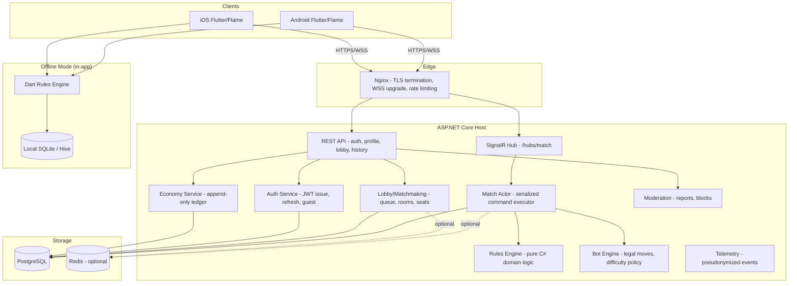
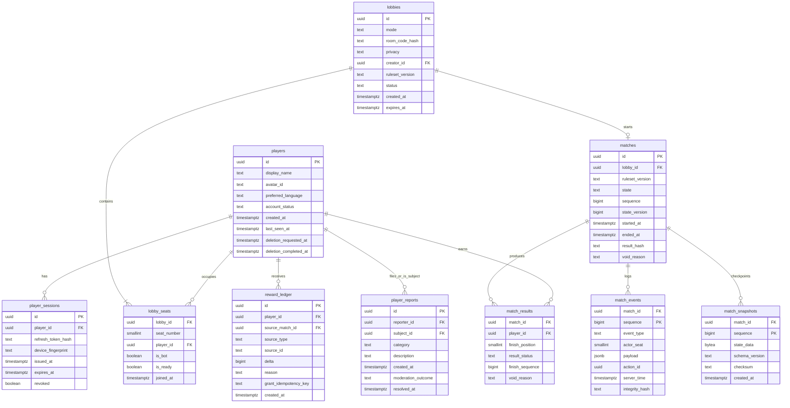

# 05 — Architecture and Data Model

**Document ID:** DM-ARCH-005
**Version:** 0.1 DRAFT — not approved
**Date:** 2026-10-20
**Status:** Phase 1 specification only. No implementation code.

## Purpose

Define the system architecture, technology stack, logical topology, service module responsibilities, and the complete relational data model for the Donkey multiplayer game. Establish sensitive-data boundaries, schema versioning strategy, and migration approach.

## Scope

- Technology stack selection and rationale.
- Logical deployment topology.
- Service module decomposition.
- Full entity-relationship model with column specifications.
- Sensitive-data classification and access boundaries.
- Schema versioning, migration strategy, and backward compatibility.

---

## 1. Technology Stack

| Layer | Choice | Version Target | Rationale |
|---|---|---|---|
| Mobile client | Flutter (stable) + Dart | Latest stable at Phase 2 start | Single codebase for Android + iOS; rich animation support. |
| Card/table rendering | Flame engine + Flutter overlays | Flame latest stable | GPU-backed transforms, sprite batching, integrated with Flutter widget tree. See ADR-0001. |
| Offline rules engine | Pure Dart library | N/A (project internal) | No network dependency; independently testable; deterministic. |
| Online service | ASP.NET Core (.NET 10 LTS) | .NET 10.x | Current LTS as of Oct 2026; long-term support, high performance. See ADR-0002. |
| Real-time transport | ASP.NET Core SignalR | Ships with .NET 10 | WebSocket primary with fallback; ordered server-issued events. See ADR-0002. |
| REST API | ASP.NET Core minimal API | Ships with .NET 10 | Auth, profile, lobby, history, admin endpoints. |
| Persistence | PostgreSQL + EF Core | PostgreSQL 16+, EF Core 10 | ACID transactions, JSON column support, proven at scale. |
| Cache (optional) | Redis | Deferred until load measurement | Room registry, session store, SignalR backplane only if needed. Not sole durability. |
| Deployment | Ubuntu 24.04, Docker Compose, Nginx | N/A | Single VPS to start; low operational overhead. |
| Push notifications | FCM / APNs | Deferred to Phase 6+ | Not core gameplay transport. |
| Admin | React + TypeScript | Deferred to Phase 7+ | Internal moderation/reporting tool. |

### 1.1 Key Technical Constraints

- **SignalR Dart client:** The `signalr_netcore` pub.dev package requires a compatibility spike against .NET 10 WebSocket transport, mobile resume, and JWT refresh. Alternative: raw WebSocket with custom message framing. See ADR-0002.
- **.NET 10 LTS:** Verify LTS support window at Phase 2 start. Reference: https://dotnet.microsoft.com/en-us/platform/support/policy/dotnet-core
- **Flame engine:** Verify iOS Metal rendering pipeline compatibility. See ADR-0001.

---

## 2. Logical Topology



### 2.1 Separation of Concerns

- **Flutter/Flame** handles rendering, animation, and user input only. It is never the authority for online game state.
- **SignalR Hub** accepts player intentions (`PlayCard`, `JoinMatch`, etc.) and broadcasts seat-filtered events. It does not contain game logic.
- **Match Actor** is a per-match serialized command executor. One actor per active match. No concurrent mutations.
- **Rules Engine** is a pure function library: given state + action, return new state + events. No I/O, no database, no networking. Testable in isolation.
- **Dart Rules Engine** is the offline counterpart, implementing the identical ruleset. Cross-language golden fixtures ensure parity. See [07-offline-online-parity-strategy.md](07-offline-online-parity-strategy.md).

---

## 3. Service Module Responsibilities

### 3.1 Identity / Auth Service

- Issue anonymous guest JWT (no email/password required for first play).
- Short-lived access tokens (15 min proposed), refresh token rotation with hashed storage.
- Device binding metadata for session management.
- Optional social account linking (deferred post-MVP).
- Account deletion workflow per Apple/Google requirements.
- Device reassociation after reinstall using secure refresh.

### 3.2 Lobby / Matchmaking Service

- Public queue: FIFO with ruleset/build-version compatibility filter; TTL; duplicate-queue exclusion.
- Private room: 6–8 character alphanumeric code (high entropy), short TTL, membership caps, rate-limited join attempts.
- Seat management: 4 seats per room, join/leave/ready state tracking.
- Ready check: public auto-ready when 4 seats filled; private requires explicit ready from all players.
- Bot seat injection: only for private rooms where host opts in, or public queue timeout fallback with user consent.

### 3.3 Match Coordinator / Actor

- Per-match serialized command queue (actor pattern).
- Monotonic sequence and version tracking.
- Timeout scheduler (server-side deadlines, never device clocks).
- Reconnection handling: snapshot delivery, event replay, seat reclaim.
- Ownership lease/fencing for multi-worker scenarios (future).

### 3.4 Rules Engine (C#)

- Pure domain logic: validate action → compute next state → emit events.
- No dependencies on database, networking, or framework.
- Shared ruleset version identifier on every match.
- Identical behavior to Dart offline engine for same inputs.

### 3.5 Bot Engine

- Queries `GetLegalMoves` through Rules Engine.
- Easy: random selection from legal moves (seeded RNG, not CSPRNG).
- Normal: rank conservation, suit exhaustion, estimated hit probability using only information visible to the bot's seat.
- Decision delay is cosmetic (400–1200ms animation); never extends server deadline.
- Deterministic replay using ruleset version + bot policy + seed.

### 3.6 Persistence / Event Journal

- Append-only match event journal: source of truth for match state.
- Periodic snapshot compaction for fast recovery.
- Match history queries for participants (filtered views).
- Integrity hashes on events and snapshots.
- Backup/restore capability.

### 3.7 Economy Service

- Append-only ledger with idempotent reward grants.
- `(sourceType, sourceId, playerId)` unique grant key.
- Offline coins are completely separate from online balance.
- Server-confirmed ad reward callbacks.
- Refund reconciliation hooks (future).

### 3.8 Moderation Service

- Player reports with categories.
- Mute/block between players.
- Abuse log retention with configurable limits.
- Admin review workflow (future).

### 3.9 Telemetry Service

- Pseudonymized structured event logging.
- Match correlation IDs.
- No private hand data in any log, metric, or crash export.
- Error budgets and alerting thresholds.

---

## 4. Data Model

### 4.1 Entity-Relationship Diagram



### 4.2 Detailed Entity Specifications

#### 4.2.1 `players`

| Column | Type | Constraints | Description |
|---|---|---|---|
| `id` | UUID | PK, default gen_random_uuid() | Unique player identity. |
| `display_name` | VARCHAR(50) | NOT NULL | Player-chosen display name. |
| `avatar_id` | VARCHAR(50) | NOT NULL, default 'default' | Selected avatar identifier. |
| `preferred_language` | VARCHAR(10) | NOT NULL, default 'en' | ISO language code (en, ml). |
| `account_status` | VARCHAR(20) | NOT NULL, default 'active' | active, suspended, deletion_pending, deleted. |
| `created_at` | TIMESTAMPTZ | NOT NULL, default now() | Account creation time. |
| `last_seen_at` | TIMESTAMPTZ | NOT NULL | Last authenticated activity. |
| `deletion_requested_at` | TIMESTAMPTZ | NULL | When deletion was requested (Apple/Google compliance). |
| `deletion_completed_at` | TIMESTAMPTZ | NULL | When deletion was executed. |

**Indexes:** `players(account_status)` for active player queries. `players(deletion_requested_at)` for deletion job processing.

#### 4.2.2 `player_sessions`

| Column | Type | Constraints | Description |
|---|---|---|---|
| `id` | UUID | PK | Session identifier. |
| `player_id` | UUID | FK → players(id), NOT NULL | Owning player. |
| `refresh_token_hash` | VARCHAR(128) | NOT NULL | Bcrypt/Argon2 hash of refresh token. **Never store plaintext.** |
| `device_fingerprint` | VARCHAR(255) | NULL | Device metadata for session management. |
| `issued_at` | TIMESTAMPTZ | NOT NULL | Token issuance time. |
| `expires_at` | TIMESTAMPTZ | NOT NULL | Absolute expiry. |
| `revoked` | BOOLEAN | NOT NULL, default false | Revocation marker. |

**Indexes:** `player_sessions(player_id, revoked)` for active session lookup. `player_sessions(expires_at)` for cleanup.

**Sensitive:** `refresh_token_hash` is stored hashed. `device_fingerprint` is internal-only, never exposed to other players.

#### 4.2.3 `lobbies`

| Column | Type | Constraints | Description |
|---|---|---|---|
| `id` | UUID | PK | Lobby/room identifier. |
| `mode` | VARCHAR(20) | NOT NULL | public, private. |
| `room_code_hash` | VARCHAR(128) | NULL | Hash of private room code. Only for private mode. |
| `privacy` | VARCHAR(20) | NOT NULL | public, invite_only. |
| `creator_id` | UUID | FK → players(id), NULL | Room creator (NULL for system-created public lobbies). |
| `ruleset_version` | VARCHAR(20) | NOT NULL | Locked ruleset version for this room. |
| `status` | VARCHAR(20) | NOT NULL | waiting, full, in_game, closed, expired. |
| `created_at` | TIMESTAMPTZ | NOT NULL | Room creation time. |
| `expires_at` | TIMESTAMPTZ | NOT NULL | Room TTL expiry. |

**Indexes:** Unique partial index on `room_code_hash WHERE status IN ('waiting', 'full')` for active room code lookup. `lobbies(status, created_at)` for matchmaking queries.

#### 4.2.4 `lobby_seats`

| Column | Type | Constraints | Description |
|---|---|---|---|
| `lobby_id` | UUID | FK → lobbies(id), NOT NULL | Parent lobby. |
| `seat_number` | SMALLINT | NOT NULL, CHECK (0–3) | Seat position (0-indexed, clockwise). |
| `player_id` | UUID | FK → players(id), NULL | NULL if seat is vacant or bot. |
| `is_bot` | BOOLEAN | NOT NULL, default false | Whether seat is occupied by a bot. |
| `is_ready` | BOOLEAN | NOT NULL, default false | Ready status for private room ready-check. |
| `joined_at` | TIMESTAMPTZ | NOT NULL | When seat was taken. |

**PK:** `(lobby_id, seat_number)`.

**Indexes:** Unique partial index on `(lobby_id, player_id) WHERE player_id IS NOT NULL` to prevent same player in multiple seats.

#### 4.2.5 `matches`

| Column | Type | Constraints | Description |
|---|---|---|---|
| `id` | UUID | PK | Match identifier / correlation ID. |
| `lobby_id` | UUID | FK → lobbies(id), NOT NULL | Source lobby. |
| `ruleset_version` | VARCHAR(20) | NOT NULL | Exact ruleset version used. |
| `state` | VARCHAR(40) | NOT NULL | Current match lifecycle state. |
| `sequence` | BIGINT | NOT NULL, default 0 | Last committed event sequence number. |
| `state_version` | BIGINT | NOT NULL, default 0 | Optimistic concurrency version. |
| `started_at` | TIMESTAMPTZ | NULL | Deal time. |
| `ended_at` | TIMESTAMPTZ | NULL | Terminal state time. |
| `result_hash` | VARCHAR(128) | NULL | Hash of terminal results for integrity. |
| `void_reason` | TEXT | NULL | Reason if match was voided. |

**Indexes:** `matches(state, started_at)` for active match queries. `matches(lobby_id)`.

#### 4.2.6 `match_events`

| Column | Type | Constraints | Description |
|---|---|---|---|
| `match_id` | UUID | FK → matches(id), NOT NULL | Parent match. |
| `sequence` | BIGINT | NOT NULL | Monotonically increasing event order. |
| `event_type` | VARCHAR(40) | NOT NULL | CardPlayed, RoundResolved, PlayerFinished, etc. |
| `actor_seat` | SMALLINT | NULL | Seat that initiated (NULL for system events). |
| `payload` | JSONB | NOT NULL | Event-specific data. **SENSITIVE: contains card data.** |
| `action_id` | UUID | NULL | Client-provided idempotency key. |
| `server_time` | TIMESTAMPTZ | NOT NULL | Server timestamp at commit. |
| `integrity_hash` | VARCHAR(128) | NOT NULL | Hash chain: H(prev_hash + event_data). |

**PK:** `(match_id, sequence)`.

**Unique:** `(match_id, action_id) WHERE action_id IS NOT NULL` for idempotency.

**CRITICAL SECURITY:** The `payload` column contains full card identities and hand states. This table must NEVER be exposed to client queries. All client-facing data goes through seat-filtered DTOs that strip opponent hand information.

#### 4.2.7 `match_snapshots`

| Column | Type | Constraints | Description |
|---|---|---|---|
| `match_id` | UUID | FK → matches(id), NOT NULL | Parent match. |
| `sequence` | BIGINT | NOT NULL | Event sequence at snapshot time. |
| `state_data` | BYTEA | NOT NULL | Serialized full match state. **ENCRYPTED at rest.** |
| `schema_version` | VARCHAR(20) | NOT NULL | Serialization schema version. |
| `checksum` | VARCHAR(128) | NOT NULL | SHA-256 of state_data for integrity verification. |
| `created_at` | TIMESTAMPTZ | NOT NULL | Snapshot time. |

**PK:** `(match_id, sequence)`.

**SENSITIVE:** `state_data` contains all player hands. Encrypted at rest. Access restricted to match actor service only.

#### 4.2.8 `match_results`

| Column | Type | Constraints | Description |
|---|---|---|---|
| `match_id` | UUID | FK → matches(id), NOT NULL | Parent match. |
| `player_id` | UUID | FK → players(id), NOT NULL | Participant. |
| `finish_position` | SMALLINT | NULL | 1st, 2nd, 3rd; NULL for Donkey or draw. |
| `result_status` | VARCHAR(20) | NOT NULL | finished, donkey, draw, void. |
| `finish_sequence` | BIGINT | NULL | Event sequence at which player finished. |
| `void_reason` | TEXT | NULL | If voided, why. |

**PK:** `(match_id, player_id)`.

**Indexes:** `match_results(player_id, result_status)` for player history queries.

#### 4.2.9 `reward_ledger`

| Column | Type | Constraints | Description |
|---|---|---|---|
| `id` | UUID | PK | Ledger entry identifier. |
| `player_id` | UUID | FK → players(id), NOT NULL | Recipient. |
| `source_match_id` | UUID | FK → matches(id), NULL | Source match (NULL for ad rewards). |
| `source_type` | VARCHAR(30) | NOT NULL | match_win, match_complete, ad_reward, purchase. |
| `source_id` | VARCHAR(100) | NOT NULL | Specific source identifier. |
| `delta` | BIGINT | NOT NULL | Amount granted (positive) or deducted (negative). |
| `reason` | TEXT | NOT NULL | Human-readable reason. |
| `grant_idempotency_key` | VARCHAR(200) | UNIQUE, NOT NULL | `(sourceType, sourceId, playerId)` composite key. |
| `created_at` | TIMESTAMPTZ | NOT NULL | Grant time. |

**Indexes:** `reward_ledger(player_id, created_at)` for balance queries. Unique on `grant_idempotency_key`.

**APPEND-ONLY:** No UPDATE or DELETE operations on this table in normal operation.

#### 4.2.10 `player_reports`

| Column | Type | Constraints | Description |
|---|---|---|---|
| `id` | UUID | PK | Report identifier. |
| `reporter_id` | UUID | FK → players(id), NOT NULL | Player filing the report. |
| `subject_id` | UUID | FK → players(id), NOT NULL | Reported player. |
| `category` | VARCHAR(40) | NOT NULL | cheating, abusive, spam, other. |
| `description` | TEXT | NULL | Optional details. |
| `created_at` | TIMESTAMPTZ | NOT NULL | Report time. |
| `moderation_outcome` | VARCHAR(30) | NULL | pending, reviewed, actioned, dismissed. |
| `resolved_at` | TIMESTAMPTZ | NULL | When moderation acted. |

**Indexes:** `player_reports(subject_id, created_at)` for repeat-offender queries. `player_reports(moderation_outcome)` for pending queue.

#### 4.2.11 `asset_catalog` (deferred)

Cosmetics and pricing metadata. Schema to be designed when monetization scope is approved.

---

## 5. Sensitive-Data Boundaries

### 5.1 Classification

| Classification | Description | Examples |
|---|---|---|
| **SECRET** | Never exposed to any client, any log, any crash export. | `match_events.payload` (full hand data), `match_snapshots.state_data`, `player_sessions.refresh_token_hash`, shuffle seed before match completion. |
| **INTERNAL** | Available to owning player only via authenticated API; never to other players. | Own hand contents, own match history details, own reward balance, `player_sessions.device_fingerprint`. |
| **PLAYER-PRIVATE** | Visible to the player and admin only. | `player_reports.description`, account deletion dates. |
| **PUBLIC-MATCH** | Visible to all match participants during or after the match. | Cards played face-up in current trick, finish positions, Donkey designation, match outcome. |
| **PUBLIC** | Visible to anyone. | Display name, avatar, match win/loss counts (if shown). |

### 5.2 Access Rules

- **REST endpoints** return seat-filtered DTOs. The `/matches/{id}/snapshot` endpoint returns only the requesting player's hand and public trick state. Opponent hands are represented as card counts only.
- **SignalR events** are filtered per recipient. `CardPlayed` includes the played card (public). `RoundResolved` includes the requesting player's updated hand but not opponents'. Reconnect `StateResync` includes own hand only.
- **Logs** must never contain card identifiers, hand contents, or shuffle seeds. Use match correlation IDs and event types only.
- **Error responses** must not leak game state. A validation error says "illegal move" not "you have [card list]."
- **Crash exports / telemetry** strip all `SECRET` and `INTERNAL` fields.
- **Database backups** encrypt `match_snapshots.state_data` at rest. Access to `match_events` table requires elevated service credentials.

---

## 6. Schema Versioning and Migration Strategy

### 6.1 Versioning

- All database schema changes are tracked as versioned, sequentially numbered migrations.
- EF Core migrations or a tool like FluentMigrator manage schema versions.
- Each migration is forward-only in production (no rollback migrations; rollback via deploying a fix-forward migration).
- A `__schema_version` or EF Core `__EFMigrationsHistory` table tracks applied migrations.

### 6.2 Migration Rules

- **No destructive changes without data preservation.** Column drops require a deprecation migration first (rename to `_deprecated_*`, remove after confirming no code references).
- **Additive changes preferred.** New columns with defaults, new tables, new indexes.
- **JSONB payloads versioned.** The `match_events.payload` JSONB includes a `schemaVersion` field. Older events are read with backward-compatible deserializers.
- **Match snapshots versioned.** `match_snapshots.schema_version` identifies the serialization format. The snapshot loader supports all historical versions.

### 6.3 Migration Workflow (Phase 2+)

1. Developer writes migration with up-only logic.
2. Migration runs in CI against a test database with realistic data.
3. Staging deployment validates migration completes within acceptable downtime window.
4. Production deployment applies migration during maintenance window (for non-online-safe changes) or as online migration (for additive changes).
5. Post-migration validation confirms data integrity.

### 6.4 Backward Compatibility

- The server supports clients one minor version behind. Clients with incompatible ruleset versions are rejected at `JoinMatch` with a version-mismatch error prompting app update.
- API versioning via URL path (`/api/v1/`, `/api/v2/`). Breaking changes get new version; old version maintained for one release cycle.

---

## 7. Infrastructure Considerations

### 7.1 Single-VPS MVP Deployment

```
┌─────────────────────────────┐
│ Ubuntu 24.04 VPS            │
│                             │
│  ┌─────────────────────┐    │
│  │ Docker Compose       │    │
│  │                     │    │
│  │  ┌──────────────┐   │    │
│  │  │ Nginx        │   │    │
│  │  │ :443 TLS     │   │    │
│  │  │ :80 redirect │   │    │
│  │  └──────┬───────┘   │    │
│  │         │           │    │
│  │  ┌──────▼───────┐   │    │
│  │  │ ASP.NET Core │   │    │
│  │  │ :5000        │   │    │
│  │  └──────┬───────┘   │    │
│  │         │           │    │
│  │  ┌──────▼───────┐   │    │
│  │  │ PostgreSQL   │   │    │
│  │  │ :5432        │   │    │
│  │  └──────────────┘   │    │
│  └─────────────────────┘    │
└─────────────────────────────┘
```

- Single ASP.NET Core process handles all matches.
- PostgreSQL on the same host (or managed database for production).
- Nginx terminates TLS and proxies HTTP/WebSocket.
- No Redis needed at MVP scale.

### 7.2 Scale-Out Path (Future)

- Add Redis for SignalR backplane and distributed session cache.
- Match actor affinity via consistent hashing or sticky sessions.
- Multiple ASP.NET Core instances behind load balancer.
- Ownership lease/fencing to prevent dual-writer on same match.
- Read replicas for match history/analytics queries.

---

## Open Questions

| ID | Question | Proposed | Cross-ref |
|---|---|---|---|
| ARCH-OQ-1 | Redis at MVP or defer? | Defer until load testing shows need. | ADR-0002, 11-development-roadmap |
| ARCH-OQ-2 | EF Core vs Dapper for data access? | EF Core for development speed; optimize hot paths later. | — |
| ARCH-OQ-3 | Snapshot frequency: every N events or every round? | Every round resolution (4 events per round × ~13 rounds ≈ 50 events). | 04-game-state-machine |
| ARCH-OQ-4 | Match event retention: how long after match completion? | 30 days then archive/purge sensitive payload; keep summary. | 08-security-privacy |

---

## Acceptance Criteria

- [ ] Every entity has defined PK, FKs, indexes, and constraints.
- [ ] Sensitive data columns are classified and access boundaries documented.
- [ ] No entity design requires opponent hand data to be exposed to clients.
- [ ] Schema supports the full match lifecycle from creation to terminal state.
- [ ] Idempotency keys prevent duplicate rewards and double-plays.
- [ ] Migration strategy supports zero-downtime additive changes.
- [ ] ER diagram matches the textual entity descriptions.

## Cross-References

- [ADR/0001-flutter-flame-2-5d.md](ADR/0001-flutter-flame-2-5d.md) — Rendering engine decision
- [ADR/0002-aspnet-core-signalr-and-durable-actors.md](ADR/0002-aspnet-core-signalr-and-durable-actors.md) — Backend and real-time decision
- [04-game-state-machine.md](04-game-state-machine.md) — Match actor behavior, state transitions
- [06-api-and-realtime-contracts.md](06-api-and-realtime-contracts.md) — API contracts that read/write these entities
- [07-offline-online-parity-strategy.md](07-offline-online-parity-strategy.md) — Offline storage model
- [08-security-privacy-and-compliance.md](08-security-privacy-and-compliance.md) — Data classification enforcement
