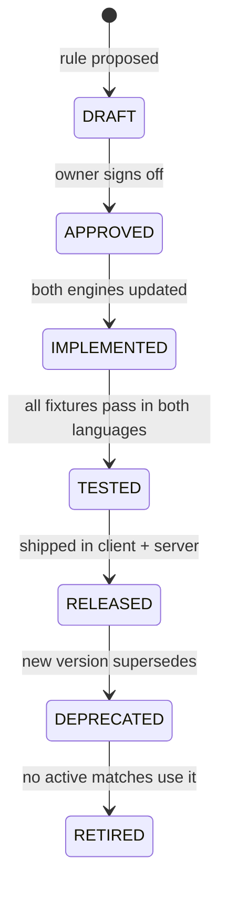
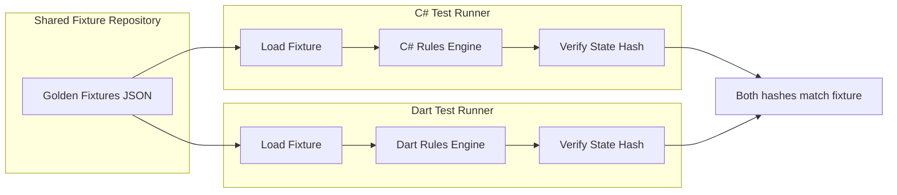
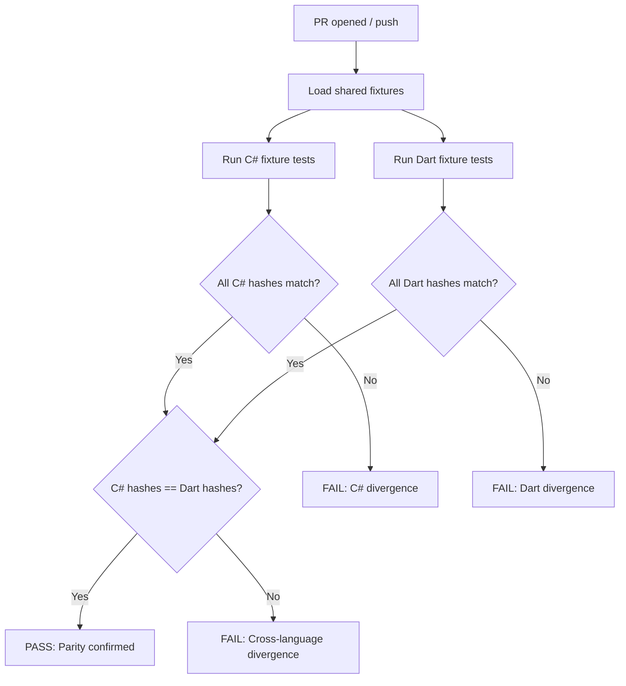

# 07 — Offline-Online Parity Strategy

**Document ID:** DM-PARITY-007
**Version:** 0.1 DRAFT — not approved
**Date:** 2026-10-20
**Status:** Phase 1 specification only. No implementation code.

## Purpose

Define the strategy for maintaining identical rule behavior between the Dart offline engine and C# online engine. Establish the golden test fixture format, cross-language CI validation, RNG handling, state persistence, version negotiation, and migration paths for rule changes.

## Scope

- Shared ruleset versioning scheme.
- Golden test fixture JSON format and generation.
- Cross-language test execution and CI integration.
- Platform RNG differences and mitigations.
- Offline state persistence format.
- Client-server version mismatch handling.
- Rule change migration strategy.

---

## 1. The Parity Problem

The Donkey game has two independent rule engine implementations:

| Engine | Language | Runtime | Purpose |
|---|---|---|---|
| **Online engine** | C# | ASP.NET Core server | Authoritative for all online matches. |
| **Offline engine** | Dart | Flutter client app | Autonomous offline play vs bots. |

Both must produce **identical outcomes** for identical inputs. A divergence means:
- Offline players learn different strategies than online play rewards.
- Golden fixture tests fail, blocking release.
- Trust in fairness is undermined.

The mitigation is a shared specification and exhaustive shared fixtures, NOT shared code (the languages differ).

---

## 2. Shared Ruleset Versioning

### 2.1 Version Identifier

Format: `DM-RULES-{major}.{minor}`

- **Major:** Breaking rule change (e.g., hit resolution changes). Both engines must update simultaneously.
- **Minor:** Clarification or edge-case fix that doesn't change outcomes for existing fixtures.

Example: `DM-RULES-1.0`

### 2.2 Version Lifecycle



### 2.3 Version Binding

- Every match record includes `rulesetVersion`.
- The server pins the ruleset version at match creation time.
- The offline engine pins the ruleset version at the client's build time.
- If the client's ruleset version is older than the server's minimum, the server rejects online match join with `VERSION_MISMATCH`.

---

## 3. Golden Test Fixture Format

### 3.1 Purpose

Golden fixtures are JSON files that encode:
1. A specific game state (initial deal or mid-game).
2. A sequence of player actions.
3. The expected resulting state after each action.

Both engines load the same fixture files and must produce byte-identical canonical state hashes.

### 3.2 Fixture JSON Schema

```json
{
  "fixtureId": "FIX-001-no-hit-basic",
  "rulesetVersion": "DM-RULES-1.0",
  "description": "Basic no-hit round: all players follow suit, highest lead-suit card wins",
  "category": "no-hit",
  "tags": ["basic", "follow-suit", "discard"],

  "initialState": {
    "hands": {
      "seat0": ["8C", "3C", "KH", "7S", "2D", "5H", "9C", "4D", "JH", "QS", "6C", "10D", "AS"],
      "seat1": ["JC", "4C", "AH", "2S", "8D", "6H", "10C", "3D", "QH", "5S", "9D", "7C", "KC"],
      "seat2": ["10S", "QC", "5C", "AD", "3H", "8S", "2C", "7D", "JD", "6S", "9H", "4H", "KD"],
      "seat3": ["2H", "QD", "JS", "AC", "4S", "8H", "10H", "3S", "6D", "9S", "5D", "7H", "KS"]
    },
    "discardPile": [],
    "currentTrick": [],
    "activePlayers": [0, 1, 2, 3],
    "finishedPlayers": [],
    "currentLeader": 0,
    "currentTurn": 0,
    "roundNumber": 1,
    "stateVersion": 0
  },

  "actions": [
    {
      "step": 1,
      "seat": 0,
      "action": "PlayCard",
      "cardId": "8C",
      "expectedResult": "ACCEPTED",
      "expectedStateAfter": {
        "currentTrick": [{"seat": 0, "cardId": "8C"}],
        "leadSuit": "clubs",
        "currentTurn": 1,
        "stateVersion": 1,
        "seat0HandCount": 12
      }
    },
    {
      "step": 2,
      "seat": 1,
      "action": "PlayCard",
      "cardId": "JC",
      "expectedResult": "ACCEPTED",
      "expectedStateAfter": {
        "currentTrick": [
          {"seat": 0, "cardId": "8C"},
          {"seat": 1, "cardId": "JC"}
        ],
        "currentTurn": 2,
        "stateVersion": 2
      }
    },
    {
      "step": 3,
      "seat": 2,
      "action": "PlayCard",
      "cardId": "QC",
      "expectedResult": "ACCEPTED",
      "expectedStateAfter": {
        "currentTrick": [
          {"seat": 0, "cardId": "8C"},
          {"seat": 1, "cardId": "JC"},
          {"seat": 2, "cardId": "QC"}
        ],
        "currentTurn": 3,
        "stateVersion": 3
      }
    },
    {
      "step": 4,
      "seat": 3,
      "action": "PlayCard",
      "cardId": "AC",
      "expectedResult": "ACCEPTED",
      "expectedStateAfter": {
        "trickComplete": true,
        "hitDetected": false,
        "roundWinner": 3,
        "cardsToDiscard": ["8C", "JC", "QC", "AC"],
        "discardPileCount": 4,
        "nextLeader": 3,
        "stateVersion": 4,
        "roundNumber": 2,
        "seat0HandCount": 12,
        "seat1HandCount": 12,
        "seat2HandCount": 12,
        "seat3HandCount": 12
      }
    }
  ],

  "illegalMoveTests": [
    {
      "description": "Seat 1 tries to play off-suit while holding clubs",
      "beforeStep": 2,
      "seat": 1,
      "action": "PlayCard",
      "cardId": "AH",
      "expectedResult": "REJECTED",
      "expectedError": "ILLEGAL_CARD"
    }
  ],

  "canonicalStateHash": "sha256:abcdef1234567890..."
}
```

### 3.3 Card Encoding

Cards use a compact two-character ID:

| Rank | Encoding | Suit | Encoding |
|---|---|---|---|
| 2–9 | `2`–`9` | Clubs | `C` |
| 10 | `10` | Diamonds | `D` |
| Jack | `J` | Hearts | `H` |
| Queen | `Q` | Spades | `S` |
| King | `K` | | |
| Ace | `A` | | |

Examples: `AS` = Ace of Spades, `10C` = 10 of Clubs, `2H` = 2 of Hearts.

The 52 valid IDs are: `{2,3,4,5,6,7,8,9,10,J,Q,K,A}{C,D,H,S}`.

### 3.4 Canonical State Hash

After each action, both engines compute a deterministic hash of the canonical state:

1. Sort all collections deterministically (hands sorted by card ID alphabetically, seats by seat number).
2. Serialize to a canonical JSON string (sorted keys, no whitespace, UTF-8).
3. SHA-256 hash the canonical string.

If the Dart and C# engines produce different hashes for the same fixture step, the test fails.

---

## 4. Fixture Categories

| Category | Description | Min fixtures |
|---|---|---|
| `no-hit` | All players follow suit; cards go to discard. | 10 |
| `hit-basic` | Single hit; leading-suit winner collects. | 10 |
| `hit-multiple` | Multiple players play off-suit. | 5 |
| `hit-offsuit-ace` | Off-suit Ace does NOT win (critical R-008 test). | 5 |
| `finisher-basic` | Player empties hand after no-hit round. | 5 |
| `finisher-hit-collection` | Player plays last card but hit winner collects (R-009). | 5 |
| `finisher-simultaneous` | Multiple players empty in same round (R-010). | 5 |
| `all-empty` | All players empty simultaneously (R-013). | 3 |
| `donkey-determination` | Last player standing is Donkey (R-012). | 5 |
| `leader-exits` | Round winner finishes; next leader clockwise (R-011). | 5 |
| `two-active-seats` | Only two players remain; tricks are two-card. | 5 |
| `illegal-moves` | Follow-suit enforcement, out-of-turn, card-not-in-hand. | 15 |
| `idempotency` | Duplicate actionId returns same result. | 5 |
| `full-game` | Complete games from deal to Donkey determination. | 10 |
| `edge-cases` | Pathological distributions, maximum round counts. | 10 |
| **Total** | | **~103** |

### 4.1 Fixture Generation

Fixtures are authored manually for specific scenarios and generated programmatically for randomized coverage:

1. **Hand-authored:** Each rule (R-001 through R-017) has at least one targeted fixture that exercises the specific edge case.
2. **Generated:** A fixture generator creates random valid deals and runs random legal bot moves through one engine, recording the full action sequence and state at each step. The other engine must reproduce the same states.
3. **Simulation sweep:** 100,000 generated fixtures run in CI to catch divergence.

**Note on simulation RNG:** Generated fixtures and simulation sweeps use a seeded deterministic PRNG (e.g., a Mersenne Twister or xoshiro256 with a recorded seed), not the platform CSPRNG. This ensures reproducibility — any failing simulation can be exactly replayed from its seed. Production shuffles use CSPRNG and are never part of parity comparisons.

---

## 5. Cross-Language Test Execution

### 5.1 Architecture



### 5.2 CI Pipeline



### 5.3 Test Runner Requirements

- Both test runners load the same JSON fixture files from a shared directory.
- Both compute state hashes using the same canonical serialization algorithm.
- Test output includes: fixture ID, step number, expected hash, actual hash, PASS/FAIL.
- On failure, the runner dumps the full state for debugging.

---

## 6. Platform RNG Differences

### 6.1 The Problem

Different platforms and languages have different random number generators. Even with the same seed, `System.Random` in C# and `Random` in Dart produce different sequences.

### 6.2 The Solution: Fixed Input Decks

**Golden test fixtures always specify the exact dealt hands.** They never rely on RNG to produce a specific deal.

For shuffling:
- **Online:** The C# server uses `System.Security.Cryptography.RandomNumberGenerator` (CSPRNG) for shuffle. The seed is never shared with clients and is not part of parity testing.
- **Offline:** The Dart client uses `dart:math` `Random.secure()` for shuffle. The seed is local.
- **Parity testing** uses pre-defined hands, not RNG. The test fixtures specify `initialState.hands` exactly.

### 6.3 Shuffle Algorithm Parity

Both engines implement the same shuffle algorithm (Fisher-Yates), but with different RNG sources. The algorithm is deterministic given a source of randomness, so parity is verified by:
1. Testing the Fisher-Yates implementation with a mock RNG that returns a fixed sequence.
2. Verifying the mock-RNG shuffle produces the same deck order in both languages.
3. Real shuffles use platform CSPRNG and are NOT compared across languages.

---

## 7. Offline State Persistence

### 7.1 Storage Format

The offline Dart engine persists game state to local storage (SQLite via `sqflite` or Hive) using the same canonical JSON serialization as the fixture format.

**Saved state includes:**
```json
{
  "saveVersion": "1.0",
  "rulesetVersion": "DM-RULES-1.0",
  "matchId": "offline-uuid",
  "createdAt": "2026-10-20T10:00:00Z",
  "lastSavedAt": "2026-10-20T10:05:00Z",
  "state": {
    "hands": {
      "seat0": ["3C", "KH", "7S"],
      "seat1": ["4C", "AH"],
      "seat2": ["QC", "5C"],
      "seat3": ["2H", "QD", "JS"]
    },
    "discardPile": ["8C", "JC", "10C", "AC"],
    "currentTrick": [],
    "activePlayers": [0, 1, 2, 3],
    "finishedPlayers": [],
    "currentLeader": 3,
    "currentTurn": 3,
    "roundNumber": 2,
    "stateVersion": 4,
    "botDifficulty": "normal",
    "botSeeds": [12345, 67890, 11111]
  },
  "stateHash": "sha256:..."
}
```

### 7.2 Save/Resume Rules

- State is saved after every round resolution and on app background.
- On resume, verify `stateHash` integrity. If corrupted, offer to start a new game (no fabricated recovery).
- The `rulesetVersion` is checked on resume. If the app has been updated to a new ruleset version, the saved game may not be resumable. Offer to start fresh. (Migration of in-progress saved games is a non-goal for MVP.)
- Bot seeds are stored for deterministic replay of bot decisions.

---

## 8. Version Mismatch Handling

### 8.1 Client Version vs Server Ruleset

| Scenario | Behavior |
|---|---|
| Client ruleset == server ruleset | Normal play. |
| Client ruleset < server minimum | `VERSION_MISMATCH` error on queue/room join. Client prompted to update app. |
| Client ruleset > server (edge case) | Theoretically impossible if server is always ahead. If it occurs, reject with version mismatch. |
| Offline saved game with old ruleset | Warn player; offer to start new game. Do NOT silently change rules mid-game. |

### 8.2 Server Ruleset Update Process

1. New ruleset version is implemented in C# engine and Dart engine.
2. All golden fixtures for the new version pass in both languages.
3. Server is deployed with the new ruleset version.
4. `GET /api/v1/rulesets/current` returns the new version with `minClientVersion`.
5. Existing active matches continue with their pinned ruleset version until completion.
6. New matches use the new ruleset version.
7. Clients below `minClientVersion` are prompted to update.

---

## 9. Rule Change Migration Strategy

### 9.1 Types of Changes

| Type | Impact | Process |
|---|---|---|
| **Bug fix** (both engines had same bug) | Minor version bump | Fix both engines, update affected fixtures, no client update forced. |
| **Clarification** (ambiguous behavior defined) | Minor version bump | Update both engines to match new definition, add fixtures. |
| **Rule change** (e.g., hit resolution changes) | Major version bump | New fixture set, both engines updated, client update required, existing matches finish on old rules. |
| **New game mode** (e.g., 2-player) | New ruleset ID entirely | Separate fixture set, independent engine code paths. |

### 9.2 Migration Checklist

- [ ] Decision register entry approved for the rule change.
- [ ] Updated canonical ruleset document with new version.
- [ ] C# engine updated with new behavior.
- [ ] Dart engine updated with new behavior.
- [ ] Existing fixtures re-validated (should still pass if minor; may change if major).
- [ ] New fixtures added for the changed behavior.
- [ ] Cross-language parity CI passes.
- [ ] Server deployed with new ruleset version.
- [ ] Client released with new Dart engine.
- [ ] `minClientVersion` updated if needed.
- [ ] Old ruleset marked deprecated; retired after all active matches complete.

---

## 10. Parity Monitoring (Post-Launch)

Even after release, parity must be continuously verified:

- **CI:** Every PR runs the full fixture suite in both languages.
- **Nightly:** Simulation sweep of 100,000 random games in both engines, comparing hashes.
- **Production telemetry:** If an offline match produces a state hash that the server engine cannot reproduce from the same actions, flag for investigation (requires client to periodically upload action logs for completed offline matches, with user consent).

---

## Open Questions

| ID | Question | Proposed | Cross-ref |
|---|---|---|---|
| PAR-OQ-1 | Should offline matches upload action logs for parity verification? | Optional with consent; not at MVP. | 08-security-privacy |
| PAR-OQ-2 | How to handle in-progress offline saves across major rule updates? | Offer to start new game; do not migrate mid-game. | — |
| PAR-OQ-3 | Should there be a shared rules specification DSL? | Not at MVP; JSON fixtures are sufficient. Evaluate after two rule versions. | — |

---

## Acceptance Criteria

- [ ] Fixture format is fully specified with JSON schema example.
- [ ] Card encoding is unambiguous (52 unique IDs defined).
- [ ] Canonical state hash algorithm is specified precisely enough for independent implementation.
- [ ] CI pipeline validates parity on every PR.
- [ ] RNG handling prevents false fixture failures.
- [ ] Offline persistence format supports save/resume with integrity verification.
- [ ] Version mismatch handling prevents rules divergence in production.

## Cross-References

- [03-canonical-ruleset-v1-draft.md](03-canonical-ruleset-v1-draft.md) — The rules both engines implement
- [04-game-state-machine.md](04-game-state-machine.md) — State transitions that both engines must handle identically
- [05-architecture-and-data-model.md](05-architecture-and-data-model.md) — Dual-engine architecture
- [06-api-and-realtime-contracts.md](06-api-and-realtime-contracts.md) — Event schema shared between engines
- [10-qa-test-matrix-and-acceptance.md](10-qa-test-matrix-and-acceptance.md) — Fixture test requirements
- [ADR/0003-two-language-rules-parity.md](ADR/0003-two-language-rules-parity.md) — Decision rationale for dual engines
