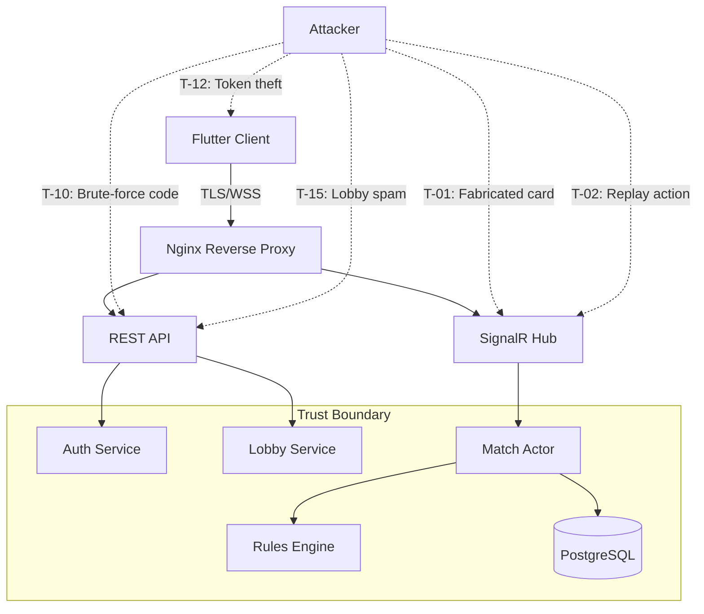
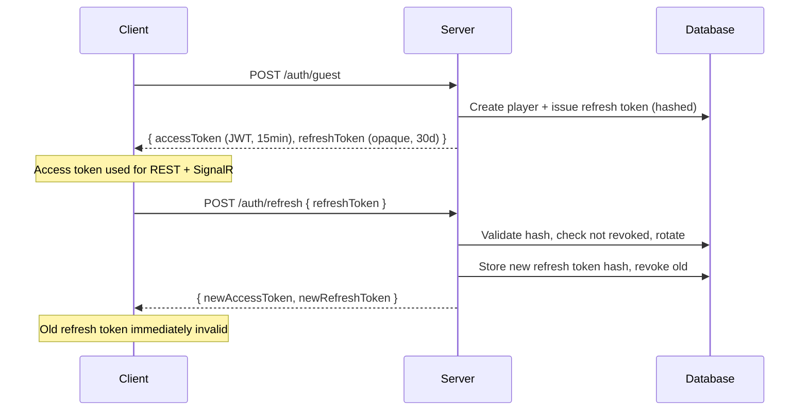
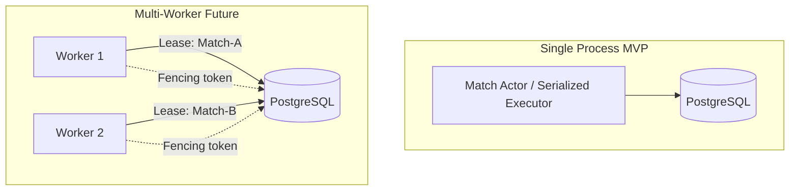
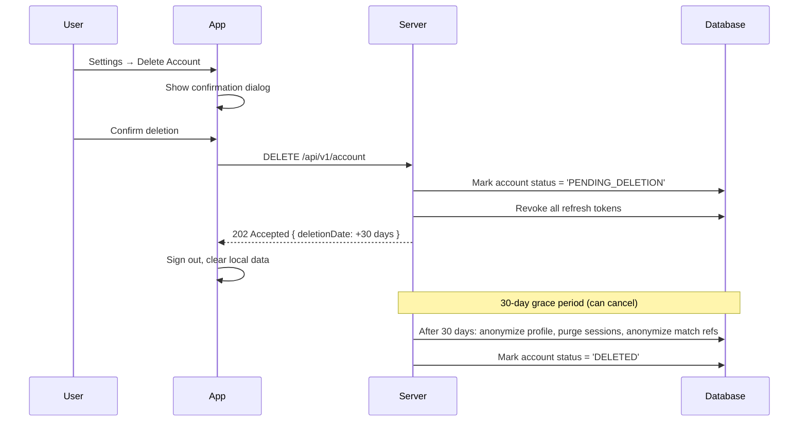

# 08 — Security, Privacy and Compliance

**Document ID:** DM-SEC-008  
**Version:** 0.1 DRAFT  
**Status:** Phase 1 — awaiting owner approval  
**Cross-references:** [05-architecture-and-data-model](05-architecture-and-data-model.md), [06-api-and-realtime-contracts](06-api-and-realtime-contracts.md), [10-qa-test-matrix-and-acceptance](10-qa-test-matrix-and-acceptance.md), [12-risks-and-decisions](12-risks-and-decisions.md)

---

## Purpose

Define the threat model, privacy obligations, store compliance requirements, and security acceptance criteria for the Donkey multiplayer game. Every control listed here must be testable before MVP launch.

## Scope

Covers the Flutter client, ASP.NET Core backend, SignalR transport, PostgreSQL persistence, and all user-facing data flows. Excludes admin web panel (post-MVP) and advanced social features.

---

## 1. Threat Model

### 1.1 Expanded Threat Table

| ID | Threat | Severity | Likelihood | Technical Controls |
|---|---|---|---|---|
| T-01 | Client fabricates card, rank, or outcome | **Critical** | High | Server-authoritative state machine; `PlayCard` validated against current hand, legal moves, active state, turn order; result never derived from client payload. |
| T-02 | Replay / duplicate / reorder actions | **Critical** | High | UUID `actionId` with unique DB constraint; `expectedStateVersion` monotonic check; duplicate `actionId` returns previously committed ack without state change. |
| T-03 | Hidden-hand exposure via payload | **Critical** | Medium | Seat-filtered DTOs on all channels (see §2); adversarial test suite for every endpoint, socket event, and log output. |
| T-04 | Hidden-hand exposure via logs/crashes | **High** | Medium | Structured logging never includes card arrays, hand contents, or match snapshots; crash reporters strip match state before upload (see §7). |
| T-05 | RNG manipulation / predictable shuffle | **Critical** | Low | OS CSPRNG (`RandomNumberGenerator` in .NET); seed never stored or transmitted before match completion; Fisher-Yates unbiased shuffle; statistical distribution test. |
| T-06 | Multi-device double action | **High** | Medium | One active session per player per match; seat ownership enforced; per-match serialized command executor; atomic version check before mutation. |
| T-07 | Fake reward / ad callback | **High** | Medium | Server-validated ad callbacks (signed URLs from ad network); append-only reward ledger with `(sourceType, sourceId, playerId)` unique key; no client-submitted reward amounts. |
| T-08 | Fake purchase / receipt | **High** | Low (MVP) | Server-side receipt validation via Play Billing API / StoreKit 2; entitlement stored server-side; no client-asserted ownership. |
| T-09 | Bot identity deception | **Medium** | Medium | All bot-controlled seats marked in UI and match results; `seat.controlledBy` field always set; no bot simulates a named human. |
| T-10 | Brute-force private room codes | **Medium** | High | 6–8 char alphanumeric (≥2 billion combinations); 5-attempt limit per IP per 10 min; 10-attempt limit per account per 10 min; room TTL ≤30 min; failed attempts logged. |
| T-11 | Malicious chat / emoji abuse | **Low** | High | Fixed emoji set only (no free text in MVP); per-user rate limit (3/10s); mute/block/report; rate-limit violations logged. |
| T-12 | Credential theft / token leakage | **Critical** | Low | TLS 1.2+ / WSS everywhere; short-lived access tokens (15 min); hashed refresh tokens in DB; OS secure storage (Keychain / EncryptedSharedPreferences); no tokens in URLs or logs. |
| T-13 | Session takeover via stolen refresh | **High** | Low | Refresh token rotation: each use invalidates old token and issues new pair; device fingerprint binding (optional); stolen token detectable via reuse. |
| T-14 | Backend failover dual-write | **Critical** | Low | Single match actor per match; fencing token / lease on ownership; durable event journal commit before broadcast; void match if reconciliation impossible. |
| T-15 | Denial of service via lobby spam | **Medium** | Medium | Rate limits: 5 room creates/min per account, 10 queue joins/min; CAPTCHA escalation for suspicious patterns; connection limits per IP. |
| T-16 | Match state corruption on restart | **High** | Low | Append-only event journal + periodic snapshots in PostgreSQL; replay from last snapshot on restart; checksum validation; void if integrity fails. |
| T-17 | Currency inflation via offline tamper | **High** | Medium | Offline coins are local-only; online wallet is server-authoritative; no sync/upload path from offline to online economy. |

### 1.2 Threat Model Diagram



---

## 2. Hidden-Hand Leak Prevention

The most critical game-integrity requirement: no player may learn another player's hand contents before match completion.

### 2.1 Controlled Channels

| Channel | Control | Test |
|---|---|---|
| **SignalR `CardPlayed` event** | Contains only: `seatIndex`, `cardId` of the played card, `stateVersion`. Never includes any hand contents. | Adversarial socket listener asserts no `hand` or `cards` arrays for other seats. |
| **SignalR `RoundResolved` event** | Contains: trick cards (already public), winner seat, hit flag, new discard/collection. Never includes resulting hand contents of any player. | Parse all event fields; assert no card arrays beyond trick cards. |
| **SignalR `MatchStarted` event** | Contains only the recipient's own 13 cards and seat assignment. Other seats show `cardCount` only. | Connect 4 clients; each asserts they see only their own cards. |
| **SignalR `StateResyncRequired`** | Reconnect snapshot: own hand, public trick, discard pile, opponent `cardCount` values. Never opponent hands. | Disconnect/reconnect test; parse snapshot for opponent card IDs. |
| **REST `GET /matches/{id}/snapshot`** | Same filtering as SignalR resync: own hand only. Requires auth + match membership. | Authenticated request with valid and invalid player IDs; assert filtering. |
| **REST `GET /matches/{id}/history`** | Post-completion only; contains deal and all events. During active match: 403 or filtered view. | Request during active match; assert no hand data. |
| **Error responses** | Validation errors (e.g., illegal move) must not include the reason derived from another player's hand. Message: "Card not in your hand" or "Must follow suit" — never "Player X holds Y." | Trigger every validation error; inspect response bodies. |
| **Server logs** | Structured log fields: `matchId`, `seatIndex`, `actionType`, `cardId` (the played card), `stateVersion`. **Never**: hand arrays, snapshot contents, opponent card IDs, shuffle seed (until completion). | Grep all log output during a full match; assert no hand content patterns. |
| **Crash reports** | Exception handlers strip match state before sending to crash reporter. Breadcrumbs include match phase and seat, not card data. | Trigger a crash in match context; inspect uploaded report. |
| **Telemetry events** | Analytics events: `match_started`, `round_resolved`, `match_completed` with aggregate stats (round count, hit count). No card-level data. | Inspect telemetry payload schema; assert no card arrays. |

### 2.2 Implementation Principle

All outbound serialization for match state must go through a **seat-scoped DTO factory** that takes `(fullState, recipientSeatIndex)` and produces the filtered view. Direct serialization of the full match state object is forbidden outside of server-side persistence.

---

## 3. Authentication Security

### 3.1 Token Lifecycle



### 3.2 Token Details

| Property | Access Token | Refresh Token |
|---|---|---|
| Format | JWT (signed, not encrypted) | Opaque (256-bit random, Base64) |
| Lifetime | 15 minutes | 30 days |
| Storage (client) | In-memory or secure storage | OS secure storage (Keychain / EncryptedSharedPreferences) |
| Storage (server) | Not stored; validated by signature | SHA-256 hash stored in `player_sessions` |
| Rotation | New token on each refresh | New token on each refresh; old revoked |
| Revocation | Expires naturally; no server-side revocation needed | Revoked in DB on rotation, logout, or suspicious activity |
| Claims | `sub` (player UUID), `iat`, `exp`, `jti` | None (lookup by hash) |

### 3.3 Session Binding

- Each refresh token is bound to a device identifier (a client-generated UUID stored in secure storage, created once per install).
- Refresh from a different device ID triggers a security event and may revoke all sessions.
- SignalR connections authenticated via access token in the initial HTTP upgrade request (query string or header per SignalR convention).
- One active match seat per player; attempting to join from a second connection disconnects the first with a `ConnectionStateChanged` event.

### 3.4 What Must Never Appear in Tokens

- Player's current hand or match state.
- Internal database IDs (use UUIDs).
- Admin roles or elevated permissions (separate admin auth flow, post-MVP).

---

## 4. RNG Security

### 4.1 Shuffle Requirements

| Requirement | Detail |
|---|---|
| Source | OS CSPRNG: `System.Security.Cryptography.RandomNumberGenerator` (.NET) |
| Algorithm | Fisher-Yates (Knuth) unbiased shuffle |
| Seed | Never stored, transmitted, or logged before match completion |
| Post-match | Seed may be stored in sealed match record for audit/replay; never in client-facing API |
| Distribution test | Chi-squared test over 1M shuffles: each card position within expected variance; each suit distribution per hand within expected variance |
| Offline (Dart) | `dart:math` `Random.secure()` for local shuffles; same Fisher-Yates algorithm |
| Deterministic fixtures | Test fixtures use pre-defined decks (not RNG); RNG tested separately |

### 4.2 What Could Go Wrong

- Using `Random()` (non-cryptographic) for online shuffles → predictable sequences.
- Sending shuffle seed to client for "verification" → reveals all hands.
- Logging the deal for debugging → exposes all hands in logs.

**Control:** Code review checklist item; static analysis rule to flag non-CSPRNG usage in shuffle paths; integration test that the shuffle endpoint does not include seed in response.

---

## 5. Anti-Cheat Controls

### 5.1 Action Validation Chain

Every `PlayCard` goes through this validation sequence. Failure at any step returns rejection without state mutation.

1. **Authentication** — Valid JWT, not expired, player exists.
2. **Match membership** — Player is a seated participant in the specified match.
3. **Match state** — Match is in `WAITING_FOR_PLAY` state.
4. **Turn ownership** — It is this player's turn (current seat matches player's seat).
5. **Deadline** — Action received before turn deadline (server clock only; client clock never trusted).
6. **Card ownership** — `cardId` exists in this player's current hand.
7. **Legal move** — Card follows suit rules: if player holds any card of lead suit, the played card must be of lead suit.
8. **State version** — `expectedStateVersion` matches current version (detects stale state).
9. **Idempotency** — `actionId` checked: if already committed, return previous ack; if new, proceed.
10. **Atomic commit** — Remove card from hand, add to trick, advance version, persist event, broadcast.

### 5.2 Specific Anti-Cheat Scenarios

| Scenario | Expected Behavior |
|---|---|
| Replay same `actionId` | Return original ack; no state change |
| Different card with same `actionId` | Return original ack (first card wins); log anomaly |
| Stale `expectedStateVersion` | Reject with `VERSION_MISMATCH`; client must resync |
| Card not in hand | Reject with `CARD_NOT_IN_HAND`; no state change |
| Out of turn | Reject with `NOT_YOUR_TURN`; no state change |
| After deadline | Server already applied auto-play; reject with `DEADLINE_PASSED` |
| Modified card rank/suit | Server resolves by `cardId` lookup in authoritative hand; fabricated IDs rejected |
| Two simultaneous plays (race) | Serialized executor; first wins, second gets version mismatch |

---

## 6. Room Code Brute-Force Protection

### 6.1 Code Design

- **Length:** 6–8 alphanumeric characters (uppercase + digits, excluding ambiguous characters: 0/O, 1/I/L).
- **Entropy:** ~31 bits for 6 chars (31 char alphabet), ~36 bits for 8 chars. Sufficient given rate limits.
- **Storage:** Room codes stored as normalized uppercase hash; original code never logged.
- **TTL:** Active rooms expire after 30 minutes if match has not started.

### 6.2 Rate Limits

| Dimension | Limit | Window | Action on Exceed |
|---|---|---|---|
| Per IP | 5 join attempts | 10 minutes | 429 + exponential backoff hint |
| Per account | 10 join attempts | 10 minutes | 429 + temporary account cooldown |
| Per room | 20 total attempts | Room lifetime | Room locked; creator notified |
| Global | Monitor for distributed patterns | Rolling | Alert; potential CAPTCHA escalation |

### 6.3 Logging

- Log: attempt count, IP (hashed for retention), account ID, timestamp, success/failure.
- Never log: the room code itself (to prevent log-based code discovery).

---

## 7. Logging Exposure Controls

### 7.1 What Must NEVER Appear in Logs

| Data | Reason | Alternative |
|---|---|---|
| Player hand contents (card arrays) | Hidden-hand integrity | `handSize: 11` |
| Full match snapshot | Contains all hands | `matchId`, `stateVersion`, `phase` |
| Shuffle seed or deal order | Reveals all hands | `shuffleAlgorithm: "fisher-yates-csprng"` |
| Refresh tokens | Credential theft | `tokenHash` prefix (first 8 chars of hash) |
| Access token JWTs | Credential theft | `sub` claim (player UUID) only |
| Room codes | Code discovery | `roomId` (UUID) |
| Player IP addresses (in long-term storage) | Privacy | Hash or truncate for short-term rate-limit logs; delete within retention window |
| Ad network callback secrets | Financial fraud | `callbackValidated: true/false` |

### 7.2 Structured Logging Fields (Allowed)

```
matchId, seatIndex, actionType, cardId (the single played card — public after play),
stateVersion, sequence, roundNumber, hitFlag, winnerSeat, finisherSeat,
playerUuid, eventType, timestamp, errorCode, rejectionReason
```

### 7.3 Crash Report Sanitization

- Register a crash report sanitizer that strips any field matching `hand`, `cards`, `snapshot`, `deal`, `seed`, `token`, `refreshToken` patterns.
- Breadcrumbs: `matchId`, `phase`, `seatIndex`, `lastActionType` — never card data.
- Test: trigger a crash during match play; download crash report; grep for card-related data.

---

## 8. Backend Failover Security

### 8.1 Single-Writer Guarantee



### 8.2 Controls

| Control | Detail |
|---|---|
| **Single actor per match** | MVP: one process, one in-memory actor per match with serialized command queue. |
| **Fencing (future)** | If scaling to multiple workers: match ownership via PostgreSQL advisory lock or lease row with fencing token. Every write includes fencing token; stale token writes rejected. |
| **Durable commit before broadcast** | Event persisted to `match_events` table in a transaction before any SignalR broadcast. If broadcast fails, client resync recovers from DB. |
| **No dual writers** | If worker dies, new worker must acquire lease before processing any commands. Pending in-flight commands from old worker are discarded (clients retry with same `actionId`). |
| **Void on irrecoverable** | If snapshot checksum fails or event replay produces inconsistent state, match transitions to `VOIDED`. No competitive outcome or reward granted. |
| **Snapshot checksums** | Each snapshot includes SHA-256 of serialized state. On recovery, checksum verified before replay continues. |

---

## 9. Purchase and Reward Fraud Prevention

### 9.1 Reward Grants (Ads)

- Rewarded ad completion verified via server-side callback from ad network (e.g., Google AdMob S2S).
- Callback URL includes signed parameters; server validates signature before granting reward.
- Reward stored in append-only `reward_ledger` with unique key `(sourceType='ad', sourceId=<callbackId>, playerId)`.
- Duplicate callbacks (same `sourceId`) are idempotent; no double grant.
- Client cannot trigger reward without valid server callback.

### 9.2 In-App Purchases (Post-MVP)

- Client sends purchase token/receipt to server.
- Server validates via Google Play Developer API / Apple App Store Server API.
- Entitlement stored server-side; client queries entitlement status.
- Refund webhooks handled: revoke entitlement on confirmed refund.
- No client-asserted ownership; UI reflects server entitlement state.

### 9.3 Economy Isolation

- **Online wallet:** Server-authoritative; modified only by validated reward grants and verified purchases.
- **Offline coins:** Local-only; stored in device storage; no upload/sync to server.
- **No transfer:** No mechanism to move currency between players or between offline/online wallets.
- **No conversion:** No mechanism to convert in-game currency to real money.

---

## 10. Privacy and Data Handling

### 10.1 Data Retention Matrix

| Data Category | Retention | Deletion Trigger | Notes |
|---|---|---|---|
| Player profile (name, avatar, language) | Until account deletion | Account deletion request | Anonymize within 30 days of request |
| Player sessions (token hashes, device info) | 90 days after last use | Account deletion or expiry | Auto-cleanup job |
| Match events (game log) | 90 days after match end | Account deletion (anonymize player refs) | Sensitive; server-only access |
| Match results | Indefinite (anonymized after deletion) | Account deletion anonymizes player reference | Aggregate stats preserved |
| Reward ledger | 1 year | Account deletion (anonymize) | Financial audit trail |
| Player reports | 180 days | Auto-expire unless escalated | Moderation use only |
| Technical logs | 7–30 days | Auto-rotate | No PII; no card data |
| Crash reports | 90 days | Auto-expire | Sanitized; no card data |
| Analytics events | 90 days | Auto-expire | Pseudonymized; coarse identifiers |

### 10.2 Account Deletion Workflow



### 10.3 Apple ATT Compliance

- If any tracking (cross-app advertising identifiers, third-party analytics that tracks across apps) is used, request ATT permission via `AppTrackingTransparency` framework **before** any tracking begins.
- If user denies ATT: use only contextual/nonpersonalized ads; no IDFA collection.
- **Recommended MVP approach:** No cross-app tracking; use only first-party pseudonymous analytics. This avoids ATT requirement entirely.
- If ATT is needed later, add it with a clear purpose string explaining why.

### 10.4 Apple Data Safety / Privacy Labels

Required disclosures for App Store submission:

| Data Type | Collected? | Linked to Identity? | Used for Tracking? | Purpose |
|---|---|---|---|---|
| User ID (guest UUID) | Yes | Yes | No | App functionality |
| Device ID (install UUID) | Yes | No | No | Session binding |
| Game progress | Yes | Yes | No | App functionality |
| In-app purchases | Yes (post-MVP) | Yes | No | App functionality |
| Crash data | Yes | No | No | App functionality |
| Performance data | Yes | No | No | App functionality |

### 10.5 Google Play Data Safety

Similar to Apple but uses Google's Data Safety form. Key declarations:
- Data collected: user ID, device ID, gameplay data, crash logs.
- Data shared: none (unless ad network SDK shares data — disclose if applicable).
- Data encrypted in transit: yes (TLS).
- Data deletion mechanism: yes (in-app account deletion).

---

## 11. Store Compliance

### 11.1 Apple App Store

| Requirement | Status | Action |
|---|---|---|
| Account deletion in-app | **Required** | Implement via `DELETE /api/v1/account` with in-app UI. Ref: [Apple docs](https://developer.apple.com/support/offering-account-deletion-in-your-app/) |
| ATT if tracking | **Conditional** | Avoid cross-app tracking at MVP to skip ATT. |
| StoreKit for purchases | **Required (post-MVP)** | Server-side receipt validation via App Store Server API. |
| No real-money gambling | **Required** | Economy design: no wagering, no cash-out, no transferable currency. |
| Age rating | **Required** | Declare as card game; no simulated gambling if no betting mechanic. Review IARC rating. |
| Privacy policy URL | **Required** | Must be accessible before submission. |

### 11.2 Google Play Store

| Requirement | Status | Action |
|---|---|---|
| Ads policy | **Required** | No full-screen ads during active gameplay. Rewarded ads opt-in only. Post-result interstitials with frequency cap. Ref: [Google Play ads policy](https://support.google.com/googleplay/android-developer/answer/9857753) |
| Play Billing for purchases | **Required (post-MVP)** | Server-side verification via Google Play Developer API. Ref: [Play Billing backend](https://developer.android.com/google/play/billing/backend) |
| Data Safety form | **Required** | Complete before submission. |
| Account deletion | **Required** | Same as Apple. |
| Simulated gambling | **Review** | If game is perceived as gambling: may require additional disclosures. Our economy has no wagering — should classify as card game, not gambling. |

### 11.3 India Regional Compliance

| Concern | Assessment | Action |
|---|---|---|
| Real-money gambling laws | **Not applicable** | No real-money wagering, prizes, cash-out, or transferable currency. |
| Simulated gambling | **Low risk** | Card game with no betting mechanic; cosmetic-only economy. Review state-specific regulations before launch. |
| Data protection (DPDPA 2023) | **Applicable** | Consent for data collection; deletion mechanism; data minimization; purpose limitation. |
| Payment regulations | **Post-MVP** | RBI regulations for in-app purchases; handled via Play/App Store billing (platform-compliant). |
| Content rating | **Required** | IARC rating through Play Store / App Store submission process. |

---

## 12. Acceptance Criteria (Testable Statements)

### Security Tests

| ID | Test | Pass Criteria |
|---|---|---|
| SEC-01 | Connect 4 clients to a match; each inspects all received SignalR events | No client receives card IDs belonging to another player's hand |
| SEC-02 | Disconnect and reconnect; inspect resync snapshot | Snapshot contains only own hand + public info |
| SEC-03 | Send `PlayCard` with a card not in hand | Server rejects with `CARD_NOT_IN_HAND`; no state change |
| SEC-04 | Send `PlayCard` when it's not your turn | Server rejects with `NOT_YOUR_TURN`; no state change |
| SEC-05 | Send `PlayCard` with stale `expectedStateVersion` | Server rejects with `VERSION_MISMATCH` |
| SEC-06 | Send duplicate `actionId` | Server returns original ack; no double play |
| SEC-07 | Send `PlayCard` after deadline | Server rejects with `DEADLINE_PASSED` |
| SEC-08 | Attempt to join room with wrong code 6 times from same IP in 10 min | 6th attempt returns 429 |
| SEC-09 | Grep all server logs during a complete match | Zero occurrences of hand arrays, shuffle seeds, or refresh tokens |
| SEC-10 | Trigger crash during match; inspect crash report | Zero card data in crash payload |
| SEC-11 | Run 1M shuffles; chi-squared test on card position distribution | Distribution within expected variance (p > 0.01) |
| SEC-12 | Attempt refresh with revoked token | Server rejects with 401; no new tokens issued |
| SEC-13 | Attempt reward grant without valid ad callback | Server rejects; no balance change |
| SEC-14 | Submit duplicate reward callback (same sourceId) | Server returns success; balance unchanged (idempotent) |
| SEC-15 | Kill backend process during match; restart; resume | Match resumes from durable state; no data loss; clients resync successfully |
| SEC-16 | Simulate dual-writer scenario (future multi-worker) | Fencing token prevents stale writer from committing |

### Privacy Tests

| ID | Test | Pass Criteria |
|---|---|---|
| PRV-01 | Request account deletion; wait 30 days | Profile anonymized; sessions purged; match refs anonymized |
| PRV-02 | Cancel deletion within grace period | Account restored; no data lost |
| PRV-03 | Inspect all API responses for a non-participant | 403 Forbidden; no match data exposed |
| PRV-04 | Verify analytics events contain no PII | Only pseudonymous identifiers; no names, emails, IPs |
| PRV-05 | Verify telemetry contains no card-level data | Only aggregate match stats |

---

## Open Questions

| ID | Question | Recommendation | Status |
|---|---|---|---|
| SEC-Q1 | Should match events be encrypted at rest or just access-controlled? | Access-controlled at MVP; encryption at rest for production. | [OPEN] |
| SEC-Q2 | Should we support "Sign in with Apple/Google" at MVP or guest-only? | Guest-only at MVP; linked sign-in post-MVP. | [PROPOSED] |
| SEC-Q3 | Should crash reports include match ID for debugging? | Yes, match ID only (no card data). | [PROPOSED] |
| SEC-Q4 | ATT: should we plan for tracking or avoid it entirely? | Avoid cross-app tracking at MVP. | [PROPOSED] |
| SEC-Q5 | India DPDPA: do we need a Data Protection Officer? | Review based on data volume thresholds; likely not for MVP. | [OPEN] |

---

## Risks and Assumptions

| Risk | Impact | Mitigation |
|---|---|---|
| SignalR event leaks hand data due to serialization bug | Critical — game integrity compromised | Adversarial test suite; seat-filtered DTO factory; code review checklist |
| Ad network SDK collects tracking data without ATT consent | Store rejection on iOS | Vet SDK privacy manifest; use Google AdMob with privacy settings; test with ATT denied |
| India state-specific gambling law classifies game as gambling | Legal risk; store removal | No wagering mechanics; legal review before launch; age-appropriate rating |
| Guest account deletion flow not implemented before submission | App Store rejection | Prioritize in Phase 6; test before submission |
| Refresh token rotation race condition | Security vulnerability | Atomic DB operation for rotation; test concurrent refresh attempts |
