# 09 — Visual, UX and Art Direction

**Document ID:** DM-VIS-009  
**Version:** 1.0-RC  
**Status:** Phase 1 complete — all rules approved; awaiting final ruleset freeze authorization  
**Cross-references:** [04-game-state-machine](04-game-state-machine.md), [10-qa-test-matrix-and-acceptance](10-qa-test-matrix-and-acceptance.md), [ADR/0001-flutter-flame-2-5d](ADR/0001-flutter-flame-2-5d.md)

---

## Purpose

Define the original visual identity, interaction design, animation system, and art production requirements for the Donkey card game. All visual direction is original — **no competitor visuals, branding, screenshots, color schemes, or layouts may be copied**.

## Scope

Covers the game table, cards, UI overlays, animations, audio, accessibility, and device adaptation. Does not cover admin panel UI or post-MVP social features.

---

## 1. Art Direction

### 1.1 Visual Identity

**Theme:** Premium private card club — intimate, warm, sophisticated. The table feels like a well-kept card room, not a casino or a children's game.

**Mood keywords:** Warm, rich, tactile, understated elegance, approachable luxury.

**What we are NOT:** Not neon/flashy casino. Not flat/minimalist mobile puzzle. Not a cartoon. Not a copy of any existing Donkey/card game app.

### 1.2 Color Palette (Design Tokens)

| Token | Light Value | Dark Value | Usage |
|---|---|---|---|
| `--color-felt` | `#1B5E3A` (deep emerald) | `#0F3D25` (darker emerald) | Table surface |
| `--color-felt-highlight` | `#247A4D` | `#1B5E3A` | Table center / active area |
| `--color-accent-gold` | `#C4943E` (muted gold) | `#D4A84E` | Turn indicators, winner highlights |
| `--color-accent-copper` | `#B87333` | `#C8834D` | Secondary accents, buttons |
| `--color-card-face` | `#FFFEF5` (warm white) | `#FFFEF5` | Card face background |
| `--color-card-back` | `#2C1810` (dark mahogany) | `#1E100A` | Card back base |
| `--color-card-back-pattern` | `#C4943E` | `#D4A84E` | Card back decorative pattern |
| `--color-text-primary` | `#1A1A1A` | `#F0EDE8` | Primary text |
| `--color-text-secondary` | `#5A5A5A` | `#A09A90` | Secondary/muted text |
| `--color-surface` | `#F5F0E8` (warm cream) | `#1E1A14` (dark warm) | UI panels, overlays |
| `--color-surface-elevated` | `#FFFFFF` | `#2A2520` | Cards, dialogs |
| `--color-error` | `#C0392B` | `#E74C3C` | Illegal moves, errors |
| `--color-success` | `#27AE60` | `#2ECC71` | Valid plays, finish |
| `--color-hit-glow` | `#E67E22` (amber) | `#F39C12` | HIT indicator glow |

### 1.3 Typography

| Usage | Font Family | Size (logical px) | Weight |
|---|---|---|---|
| Card rank/suit | Custom card font or system serif | 18–24 | Bold |
| Player names | System sans-serif (e.g., Roboto/SF Pro) | 14–16 | Medium |
| UI labels | System sans-serif | 12–14 | Regular |
| Turn countdown | System monospace or tabular nums | 20–28 | Bold |
| Headings (menus) | System sans-serif | 18–22 | SemiBold |
| Malayalam text | Noto Sans Malayalam / system Malayalam | Same as English equivalent | Same |

**Malayalam considerations:** Malayalam script is taller and wider than Latin. All UI containers must accommodate ≥1.3x horizontal expansion and ≥1.2x vertical expansion without truncation or overflow. Test with longest Malayalam strings.

---

## 2. Table Design

### 2.1 Perspective Surface

The table is a **pre-rendered 2D image with perspective applied**, not a real-time 3D surface. This gives the 3D appearance without GPU cost.

- **Portrait (phone):** Slightly top-down oblique view (~15° from vertical). Player's hand at bottom, opponents at top and sides.
- **Tablet landscape:** More traditional top-down view with wider table visible.

### 2.2 Seat Layout (Portrait Default)

```
┌─────────────────────────┐
│      [Opponent Top]      │
│    Name  ██ cardCount    │
│                          │
│ [Opp   ┌──────────┐ [Opp│
│  Left]  │  TABLE   │ Right]
│  Name   │  CENTER  │ Name│
│  ██ cnt │ (trick)  │ ██ cnt
│         └──────────┘     │
│                          │
│   Lead: ♣  Timer: 15s    │
│                          │
│  ┌──┬──┬──┬──┬──┬──┬──┐ │
│  │  │  │  │  │  │  │  │ │
│  │ Player's Hand Cards │ │
│  └──┴──┴──┴──┴──┴──┴──┘ │
│      [Play Button]       │
└─────────────────────────┘
```

### 2.3 Table Art Requirements

| Asset | Format | Dimensions | Variants |
|---|---|---|---|
| Table felt background (portrait) | PNG/WebP | 1080×1920 @2x, 1440×2560 @3x | Light felt, dark felt |
| Table felt background (tablet) | PNG/WebP | 2048×1536 @2x | Light felt, dark felt |
| Table center highlight | PNG with alpha | 600×400 @2x | Active/inactive |
| Seat position markers | PNG with alpha | 80×80 @2x | Active turn / waiting / finished / disconnected |

---

## 3. Card Design

### 3.1 Card Dimensions and Layout

| Property | Value |
|---|---|
| Card aspect ratio | 2.5:3.5 (standard poker ratio) |
| Logical size (in hand) | 52×73 logical pixels (minimum) |
| Logical size (in trick) | 60×84 logical pixels |
| Touch target | ≥48×48 logical pixels per card in hand |
| Corner radius | 4–6 logical pixels |

### 3.2 Card Face Design

- **Original artwork required.** Do not copy any existing card game's face design.
- Standard indices: rank in top-left and bottom-right corners; suit symbol beside rank.
- Suit symbols: ♠ ♥ ♦ ♣ — standard Unicode glyphs or custom rendered. Red for hearts/diamonds, black for spades/clubs.
- Face cards (J, Q, K): Original illustrated figures or stylized geometric designs.
- Number cards: suit pips arranged in standard layout.
- Ace of Spades: Distinctive larger design (it's the game-starting card).

### 3.3 Card 3D-Effect Techniques (2.5D)

All 3D appearance is achieved through layered 2D effects:

| Effect | Technique | Performance Cost |
|---|---|---|
| **Card depth/thickness** | Thin shadow layer below card; slight offset | Low — one extra sprite per card |
| **Card lift on select** | Scale up 1.05x + larger shadow offset + slight Y translate | Low — transform only |
| **Card highlight** | Semi-transparent white gradient overlay on top edge | Low — single overlay |
| **Card flip** | Scale X from 1→0 (face) then 0→1 (back) with slight Y arc | Medium — two-phase animation |
| **Table reflection** | Subtle blurred card reflection below play area | Medium — optional; skip on low quality |
| **Perspective skew** | Cards at top of table slightly narrower (CSS-style perspective transform) | Low — matrix transform |
| **Dealing arc** | Cards move from deck position to hand with slight arc and rotation | Low — path animation |

### 3.4 Card Sprite Sheet Requirements

| Asset | Format | Per Card | Total |
|---|---|---|---|
| Card faces (52) | PNG atlas | 208×292 @2x | 4 rows × 13 cols atlas (~2700×1168) |
| Card faces (52) @3x | PNG atlas | 312×438 | 4 rows × 13 cols atlas (~4056×1752) |
| Card back | PNG | 208×292 @2x, 312×438 @3x | 1 design + 2–3 variants |
| Card shadow | PNG with alpha | 220×304 @2x | 1 reusable shadow layer |
| Card highlight | PNG with alpha | 208×292 @2x | 1 reusable highlight overlay |
| Card select glow | PNG with alpha | 230×314 @2x | 1 reusable glow effect |

**Total texture memory estimate:** ~8–12 MB for @2x; ~18–25 MB for @3x. Well within mobile GPU limits.

---

## 4. Animation Budget

### 4.1 Animation Timings

| Animation | Duration | Easing | Reduced Motion Alternative |
|---|---|---|---|
| **Deal** (13 cards to each player) | 150–250 ms per card burst (staggered) | ease-out | Instant appear with fade-in (200 ms total) |
| **Card select** (lift from hand) | 120–180 ms | ease-out | Immediate highlight change |
| **Card play** (hand to table center) | 180–280 ms | ease-in-out | Instant move (no arc) |
| **Round collect** (trick to winner) | 450–650 ms | ease-in then ease-out | Fade out trick (200 ms) |
| **Round discard** (trick fades out) | 300–400 ms | ease-out (fade) | Instant remove |
| **Card flip** (reveal/hide) | 250–350 ms | ease-in-out | Instant swap face/back |
| **Turn indicator pulse** | 800–1200 ms loop | sine | Static highlight (no pulse) |
| **HIT glow** | 400–600 ms | ease-out | Amber border (no glow animation) |
| **Finisher exit** | 500–700 ms (cards fan out and fade) | ease-in | Instant remove |
| **Result screen entry** | 300–500 ms (staggered podium) | spring | Instant appear |

### 4.2 Animation Principles

1. **Purposeful:** Every animation communicates game state — a card moving to center means "played," a collection sweep means "hit resolved."
2. **Interruptible:** No animation blocks input for the next required action. If it's the player's turn, the play button is active even during prior animations.
3. **Budget-aware:** Total animation per round ≤1.5 seconds of wall time. Players should not wait for animations.
4. **Reduced motion:** All animations have a non-animated fallback. Check `MediaQuery.disableAnimations` / platform accessibility setting.

### 4.3 Frame Rate Targets

| Quality Preset | Target FPS | Notes |
|---|---|---|
| High | 60 FPS | All effects, shadows, reflections |
| Medium | 60 FPS | No reflections, simpler shadows |
| Low | 30 FPS acceptable, 60 target | No shadows, no particle effects, simpler transitions |

---

## 5. Input Design

### 5.1 Card Selection and Play

```mermaid
stateDiagram-v2
    [*] --> HandDisplayed: Cards dealt
    HandDisplayed --> CardSelected: Tap legal card
    HandDisplayed --> IllegalFeedback: Tap illegal card
    IllegalFeedback --> HandDisplayed: 500ms hint shown
    CardSelected --> HandDisplayed: Tap same card (deselect)
    CardSelected --> CardSelected: Tap different legal card
    CardSelected --> CardPlayed: Tap Play button
    CardSelected --> CardPlayed: Double-tap selected card (optional shortcut)
    CardPlayed --> [*]: Animation plays; wait for server ack
```



### 5.2 Interaction Details

| Interaction | Behavior | Accessibility |
|---|---|---|
| **Tap legal card** | Card lifts (scale + shadow), Play button appears/activates | Focus ring visible; screen reader: "Selected [Rank] of [Suit]" |
| **Tap illegal card** | Card shakes briefly; hint text appears: "Must follow [Suit]" | Screen reader: "Cannot play [Rank] of [Suit] — must follow [Lead Suit]" |
| **Tap Play button** | Selected card animates to table center; Play button deactivates | Screen reader: "Played [Rank] of [Suit]" |
| **Drag (optional)** | Drag card toward table center; release in zone to play; release outside to cancel | Not required for accessibility; tap is primary |
| **Tap opponent area** | Show opponent name/status tooltip | Screen reader: "[Name], [cardCount] cards remaining" |
| **Long press card (own)** | Zoom view of card | Screen reader: full card description |

### 5.3 Touch Targets

- Minimum touch target: **44×44 logical pixels** (Apple HIG) / **48×48** (Material).
- Cards in a 13-card hand on a 360px-wide phone: ~27px per card if evenly spaced. **Solution:** overlapping fan layout; the tappable area of each card extends from its visible left edge to the next card's left edge, with the rightmost card fully tappable. Minimum exposed width per card: 24px (with full card height as touch area).
- Play button: ≥48×48 logical pixels, centered below hand.

---

## 6. UI Overlay Layout

### 6.1 Information Hierarchy

| Priority | Element | Position | Always Visible? |
|---|---|---|---|
| 1 | Player's hand | Bottom 30% of screen | Yes (during play) |
| 2 | Current trick (played cards) | Center of table | Yes (during round) |
| 3 | Turn indicator + countdown | Near active seat | Yes (during play) |
| 4 | Lead suit indicator | Above trick area | Yes (during round) |
| 5 | Opponent card counts | Near each opponent seat | Yes |
| 6 | HIT indicator | Center, overlaying trick | On HIT event only |
| 7 | Round history | Swipe-up panel or icon tap | On demand |
| 8 | Emoji reactions | Floating near seat | Temporary (3s) |
| 9 | Connection status | Top bar | Only when disconnected |

### 6.2 Lead Suit Indicator

- Large suit glyph (♠♥♦♣) displayed prominently above the trick area when a round is in progress.
- Color-coded: black for ♠♣, red for ♥♦.
- Text label below glyph: "Lead: Spades" / "ലീഡ്: സ്പേഡ്‌സ്" (Malayalam).
- **Not color-only:** Suit shape + text ensures colorblind accessibility.

### 6.3 Turn Countdown

- Circular progress indicator or digital countdown near the active seat.
- Visual states: >10s (normal), 5–10s (yellow/warning), <5s (red/urgent with pulse).
- Server time only; client interpolates display but never adjudicates.

---

## 7. Accessibility

### 7.1 Colorblind Safety

| Suit | Color | Shape | Pattern (high-contrast mode) |
|---|---|---|---|
| Spades ♠ | Black | Pointed top | Solid fill |
| Hearts ♥ | Red | Rounded top | Horizontal lines |
| Diamonds ♦ | Red/Blue (distinguishable from hearts) | Rotated square | Diagonal lines |
| Clubs ♣ | Black/Green (distinguishable from spades) | Trefoil | Dots |

**Critical:** Suit identity must be determinable from shape alone. Color is a secondary cue, never the only differentiator.

### 7.2 Screen Reader Support

| Element | Semantic Label |
|---|---|
| Card in hand | "[Rank] of [Suit]" — e.g., "Ace of Spades" |
| Card in hand (illegal) | "[Rank] of [Suit], cannot play — must follow [Lead Suit]" |
| Selected card | "Selected: [Rank] of [Suit]. Tap Play to confirm." |
| Opponent seat | "[Name], [N] cards remaining, [status]" |
| Lead suit | "Lead suit: [Suit]" |
| Turn indicator | "Your turn. [N] seconds remaining." / "[Name]'s turn." |
| HIT event | "HIT! [Name] played off-suit. [Winner] collects [N] cards." |
| Round result | "Round [N]: [Winner] wins with [Card]. [Hit/No hit]." |
| Match result | "Match complete. 1st: [Name], 2nd: [Name], 3rd: [Name], Donkey: [Name]." |

### 7.3 Scalable Text

- All text respects system text scaling up to 2.0x.
- At 2.0x, card indices may need repositioning; test with Flutter `textScaleFactor`.
- UI layout must not overflow or clip at max text scale.

### 7.4 Reduced Motion

- Check `MediaQuery.of(context).disableAnimations` or equivalent platform setting.
- Replace all animations with instant transitions or simple fades (≤200 ms).
- Turn indicator: static highlight instead of pulse.
- No auto-playing particle effects.

### 7.5 High Contrast Mode

- Provide a high-contrast card variant: bold outlines, larger indices, maximum color contrast.
- Table felt uses maximum contrast against card edges.
- All interactive elements have visible focus indicators.

---

## 8. Low-End Device Fallback

### 8.1 Quality Presets

| Setting | High | Medium | Low |
|---|---|---|---|
| Card shadows | Layered soft shadow | Simple drop shadow | No shadow |
| Table reflection | Yes | No | No |
| Card highlight/glow | Gradient overlay | Solid border | Solid border |
| Particle effects | Yes (subtle) | No | No |
| Animation FPS target | 60 | 60 | 30 acceptable |
| Texture resolution | @3x | @2x | @1x (generated from @2x) |
| Background detail | Full perspective + lighting | Simpler felt texture | Flat color gradient |
| Card flip animation | Full 3D-style flip | Simple cross-fade | Instant swap |

### 8.2 Auto-Detection

- On first launch, run a brief GPU benchmark (render a test scene for 2 seconds, measure FPS).
- Default quality based on benchmark result:
  - ≥55 FPS → High
  - 40–55 FPS → Medium
  - <40 FPS → Low
- User can override in Settings.

### 8.3 Memory Budget

| Category | Budget (High) | Budget (Low) |
|---|---|---|
| Card textures | 25 MB | 8 MB |
| Table/UI textures | 10 MB | 4 MB |
| Audio | 5 MB | 2 MB (fewer sounds) |
| Animation cache | 5 MB | 0 MB (no caching) |
| **Total render assets** | **45 MB** | **14 MB** |

Ensure no unbounded texture growth: card textures are atlas-based (fixed count), not dynamically generated.

---

## 9. Malayalam Layout Considerations

### 9.1 Script Characteristics

- Malayalam is an **abugida** (consonant-vowel sequences); characters are wider and taller than Latin.
- Text containers must handle ~1.3x horizontal and ~1.2x vertical expansion.
- Right-to-left: Malayalam is left-to-right, so no RTL layout changes needed.
- Numerals: use Eastern Arabic or Western Arabic numerals per user preference; default to Western Arabic for card game context.

### 9.2 Testing Checklist

| Test | Criteria |
|---|---|
| All UI strings in Malayalam | No truncation, no overflow, no clipping |
| Button labels | Text fits within button; button expands if needed |
| Card names in help/rules | Correct Malayalam names for ranks and suits |
| Turn countdown | Numeral display correct |
| Match results | Full Malayalam names + ranks displayed correctly |
| Emoji reactions | Emoji renders correctly alongside Malayalam text |
| Settings screen | All options readable in Malayalam |

### 9.3 Font Loading

- **Primary:** Noto Sans Malayalam (Google Fonts) or system Malayalam font.
- **Fallback:** System default.
- Ensure font is bundled with app (not network-loaded) for offline support.
- Test on devices with and without native Malayalam rendering support.

---

## 10. Audio and Haptics

### 10.1 Sound Events

| Event | Sound | Duration | Notes |
|---|---|---|---|
| Card deal (per card) | Soft card slide | ~150 ms | Staggered; volume ramp up |
| Card play | Card slap on felt | ~200 ms | Satisfying tactile feel |
| Card select | Soft click/lift | ~100 ms | Subtle |
| HIT event | Distinctive alert tone | ~400 ms | Must be clearly different from normal play |
| Round collect (hit winner) | Sweep/collect sound | ~500 ms | Matched to animation |
| Round discard (no hit) | Soft whoosh/fade | ~300 ms | Less prominent than collect |
| Player finishes | Achievement chime | ~600 ms | Positive; congratulatory |
| Donkey declared | Comedic/distinctive tone | ~800 ms | Memorable but not mean-spirited |
| Turn warning (<5s) | Soft tick/pulse | ~200 ms per tick | Gentle urgency |
| Timeout | Time-up buzzer | ~300 ms | Clear; not aggressive |
| Match start | Shuffle + deal ambience | ~2s | Sets the mood |
| Match end | Fanfare (short) | ~1.5s | Podium reveal |

### 10.2 Haptic Feedback

| Event | Haptic | Platform |
|---|---|---|
| Card select | Light tap | iOS: `.light`; Android: `HapticFeedback.lightImpact` |
| Card play | Medium tap | iOS: `.medium`; Android: `HapticFeedback.mediumImpact` |
| HIT event | Heavy tap + short vibration | iOS: `.heavy`; Android: custom pattern |
| Illegal card tap | Error pattern (double-tap) | iOS: `.error`; Android: custom pattern |
| Turn warning | Gentle pulse | iOS: `.light` repeated; Android: short vibrate |

### 10.3 Audio Controls

- **Master mute:** Single toggle in Settings and quick-access during gameplay.
- **Per-category (post-MVP):** SFX volume, music volume (if background music added).
- **Haptic toggle:** Separate from audio mute.
- **Throttling:** Maximum one haptic event per 200 ms to prevent buzzing. Maximum one sound overlap per channel.

---

## 11. Art Asset Deliverables Checklist

| # | Asset | Format | Variants | Priority |
|---|---|---|---|---|
| 1 | Table felt background (portrait) | PNG/WebP | @2x, @3x; light/dark | P0 |
| 2 | Table felt background (tablet landscape) | PNG/WebP | @2x; light/dark | P1 |
| 3 | 52 card faces | PNG atlas | @2x, @3x | P0 |
| 4 | Card back design | PNG | @2x, @3x; 1 default + 2 variants | P0 |
| 5 | Card shadow layer | PNG with alpha | @2x | P0 |
| 6 | Card highlight overlay | PNG with alpha | @2x | P1 |
| 7 | Card select glow | PNG with alpha | @2x | P1 |
| 8 | Suit token icons (4) | SVG + PNG | @2x, @3x | P0 |
| 9 | Default player avatars (4–8) | PNG | 128×128, 256×256 | P0 |
| 10 | Seat position indicators | PNG with alpha | Active/waiting/finished/disconnected | P0 |
| 11 | HIT indicator graphic | PNG with alpha | @2x | P0 |
| 12 | Turn countdown ring | SVG or Flame-rendered | N/A | P0 |
| 13 | Play button | SVG + PNG | Normal/pressed/disabled | P0 |
| 14 | Donkey badge/icon | PNG/SVG | @2x, @3x | P0 |
| 15 | Podium/rank badges (1st–3rd) | PNG/SVG | @2x | P0 |
| 16 | App icon | PNG | All required sizes (iOS/Android) | P0 |
| 17 | Splash screen | PNG/SVG | Portrait; responsive | P0 |
| 18 | Sound effects pack | OGG + AAC | All events listed in §10 | P0 |
| 19 | High-contrast card variant | PNG atlas | @2x | P1 |
| 20 | Animation reference (Lottie or sprite) | JSON/PNG | Deal, play, collect sequences | P1 |

---

## 12. Originality Statement

All visual assets, color schemes, card designs, table layouts, animations, sound effects, and branding for this game must be **original creations or properly licensed**. Specifically:

- **No copying** of CodeHound Donkey Master's card art, table design, UI layout, color scheme, logo, icon, sound effects, or any other visual/audio asset.
- **No screenshot tracing** or derivative works from competitor apps.
- **No use** of competitor brand names, taglines, or marketing text.
- Card face designs must be original illustrations, not reproductions of public-domain card designs associated with any specific competing product.
- The game's visual identity should be clearly distinguishable from existing Donkey card game apps in screenshots and marketing materials.

---

## Open Questions

| ID | Question | Recommendation | Status |
|---|---|---|---|
| VIS-Q1 | Should face cards have illustrated figures or geometric/abstract designs? | Illustrated figures for premium feel; geometric as fallback if art budget is tight. | [OPEN] |
| VIS-Q2 | Dark mode: separate table felt assets or dynamically darkened? | Separate assets for quality; dynamic darkening as fallback. | [PROPOSED] |
| VIS-Q3 | Should card suit colors be customizable for colorblind users? | Shape-based differentiation is primary; custom colors as a setting is nice-to-have post-MVP. | [PROPOSED] |
| VIS-Q4 | Background music during gameplay? | No for MVP; ambient sound post-MVP if user research supports it. | [PROPOSED] |
| VIS-Q5 | Landscape orientation support? | Research spike; not MVP dependency. Portrait primary. | [PROPOSED] |

---

## Acceptance Criteria

1. All cards are visually distinguishable by rank and suit without relying on color alone.
2. All text renders correctly in English and Malayalam at 1.0x and 2.0x text scale without truncation.
3. Reduced motion mode replaces all animations with instant or ≤200 ms transitions.
4. Low quality preset achieves ≥30 FPS on target low-end device (TBD in ADR).
5. High quality preset achieves ≥55 FPS on mainstream device.
6. Screen reader can announce every interactive element with correct semantic label.
7. Touch targets meet ≥44px minimum.
8. No visual asset is sourced from or derivative of competitor material.
9. Total render asset memory stays within budget (45 MB high / 14 MB low).
10. Audio mute and haptic toggle work independently; no sound leaks when muted.
