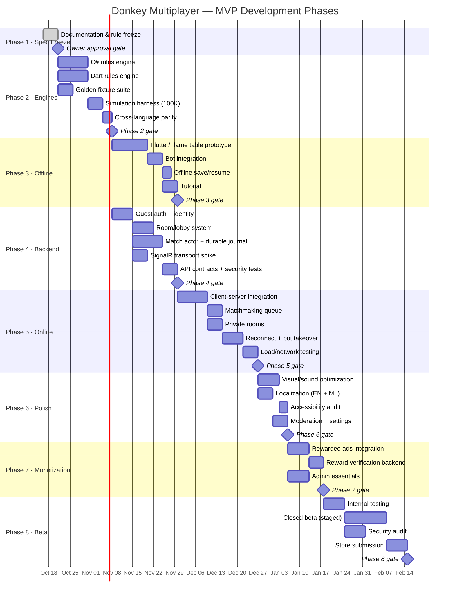
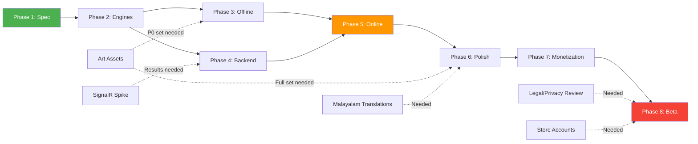
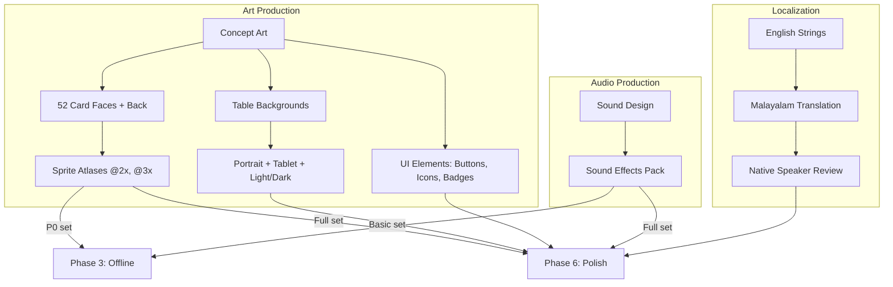
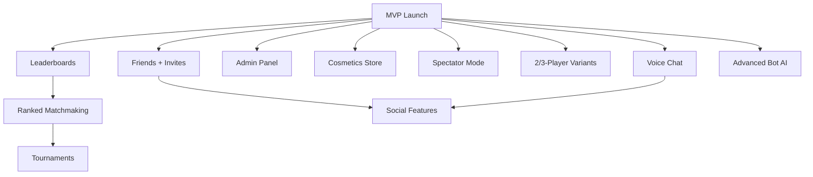

# 11 — Development Roadmap

**Document ID:** DM-ROAD-011  
**Version:** 0.1 DRAFT  
**Status:** Phase 1 — awaiting owner approval  
**Cross-references:** [01-prd-and-user-stories](01-prd-and-user-stories.md), [05-architecture-and-data-model](05-architecture-and-data-model.md), [10-qa-test-matrix-and-acceptance](10-qa-test-matrix-and-acceptance.md), [12-risks-and-decisions](12-risks-and-decisions.md)

---

## Purpose

Define the phased delivery plan with dependencies, acceptance criteria, estimated durations, and risk factors. All estimates are planning ranges, not commitments — calibrate after each phase gate.

## Scope

Covers Phases 1–8 from initial specification through closed beta release. Post-MVP items listed separately as future roadmap with prerequisites.

---

## 1. Phase Overview

---

## 2. Phase Details

### Phase 1 — Product and Rule Freeze

| Property | Detail |
|---|---|
| **Objective** | Complete specification; resolve all blocking rule ambiguities; establish architecture decisions. |
| **Deliverables** | All `docs/` files; ADRs; PHASE_1_REVIEW_REPORT; signed RULE_FREEZE_APPROVAL_CHECKLIST |
| **Dependencies** | None (initial phase) |
| **Acceptance** | All 12 blocking decisions (D01–D12) signed by owner; ruleset version `DM-RULES-1.0` issued |
| **Duration estimate** | 3–5 days (documentation) + owner review time |
| **Key risks** | Owner unavailable for sign-off; ambiguous rules require competitor gameplay study |
| **Status** | **IN PROGRESS** |

### Phase 2 — Deterministic Rules Engines

| Property | Detail |
|---|---|
| **Objective** | Implement identical rules engines in C# (server) and Dart (offline) with exhaustive test coverage. |
| **Deliverables** | C# rules library; Dart rules library; shared JSON fixture suite; 100K simulation harness; cross-language parity CI |
| **Dependencies** | Phase 1 completed: approved `DM-RULES-1.0` |
| **Acceptance** | All golden fixtures pass in both languages; 100K simulation: zero invariant violations; all state invariants (INV-001 through INV-010) verified |
| **Duration estimate** | 2–3 weeks (solo dev); 1–2 weeks (2 devs parallel) |
| **Key risks** | Edge cases in simultaneous finisher logic; language-specific floating-point or sort-order differences; fixture completeness |

### Phase 3 — Offline Playable Prototype

| Property | Detail |
|---|---|
| **Objective** | Playable offline game with Flutter/Flame 2.5D table, bot opponents, tutorial, and save/resume. |
| **Deliverables** | Flutter app with game table; card rendering; bot integration; offline save/resume; interactive tutorial; quality presets |
| **Dependencies** | Phase 2: Dart rules engine complete and passing; Art assets: minimum card faces, table, icons (P0 set) |
| **Acceptance** | Complete offline match on Android + iOS; 3 bot difficulties; save mid-game and resume; tutorial completes; ≥55 FPS on mid-range device; ≥30 FPS on low-end device |
| **Duration estimate** | 3–4 weeks (solo dev) |
| **Key risks** | Art asset production timeline; Flame rendering performance on low-end devices; Flutter/Flame version compatibility |

### Phase 4 — Backend Foundation

| Property | Detail |
|---|---|
| **Objective** | Server infrastructure: auth, rooms, durable match actor, SignalR transport, API contracts. |
| **Deliverables** | ASP.NET Core service; guest auth with JWT; room/lobby system; match actor with event journal; SignalR hub; PostgreSQL schema; Docker deployment |
| **Dependencies** | Phase 2: C# rules engine complete; SignalR Dart client compatibility spike results |
| **Acceptance** | Guest auth flow complete; room create/join/leave works; match actor processes full game; event journal survives restart; security test suite passes |
| **Duration estimate** | 2–3 weeks (solo dev); can partially overlap with Phase 3 |
| **Key risks** | SignalR Dart client compatibility with .NET 10; durable actor complexity; database migration tooling |

### Phase 5 — Online Multiplayer

| Property | Detail |
|---|---|
| **Objective** | End-to-end online play: matchmaking, private rooms, reconnection, cross-device testing. |
| **Deliverables** | Client-server integration; matchmaking queue; private room flow; reconnect + bot takeover; load testing results |
| **Dependencies** | Phase 3: Flutter client complete; Phase 4: backend complete |
| **Acceptance** | 4 human players complete matches across devices; reconnect after 30s disconnect works; bot takeover disclosed and functional; load test L2 (100 clients) passes; all network resilience tests pass |
| **Duration estimate** | 2–3 weeks |
| **Key risks** | WebSocket reliability on mobile networks; reconnection edge cases; load test infrastructure setup |

### Phase 6 — Polish and Safety

| Property | Detail |
|---|---|
| **Objective** | Production quality: visual polish, sound, localization, accessibility, moderation, settings. |
| **Deliverables** | Visual effects and sound integration; English + Malayalam localization; accessibility audit results; moderation (mute/report); settings UI; privacy/delete account flow |
| **Dependencies** | Phase 5: online multiplayer working; Full art asset set; Malayalam translations |
| **Acceptance** | Malayalam UI renders correctly everywhere; accessibility audit passes; reduced motion works; account deletion flow works; moderation flow works |
| **Duration estimate** | 2–3 weeks |
| **Key risks** | Malayalam translation quality; accessibility issues on specific devices; art asset revisions |

### Phase 7 — Monetization and Operations

| Property | Detail |
|---|---|
| **Objective** | Optional rewarded ads, reward verification, operational essentials. |
| **Deliverables** | Ad SDK integration (Google AdMob or equivalent); server-side reward verification; admin monitoring essentials; backup/restore tested; deployment automation |
| **Dependencies** | Phase 6: polish complete; Ad network account and SDK |
| **Acceptance** | Rewarded ad plays and grants verified reward; no ads during active tricks; offline coins isolated; backup/restore demonstrated; health checks operational |
| **Duration estimate** | 1–2 weeks |
| **Key risks** | Ad SDK approval process; reward callback reliability; store policy changes |

### Phase 8 — Closed Beta and Release

| Property | Detail |
|---|---|
| **Objective** | Staged release with real users; security audit; store submission. |
| **Deliverables** | Internal testing feedback incorporated; closed beta (TestFlight / Play Console internal track); security audit report; store listings and disclosures; launch rollback tested |
| **Dependencies** | All prior phases complete; privacy policy published; store accounts set up |
| **Acceptance** | All MVP exit criteria met (see [10-qa-test-matrix](10-qa-test-matrix-and-acceptance.md) §12.2); crash-free rate ≥99.5% in beta; zero P0/P1 bugs; store submission accepted |
| **Duration estimate** | 2–4 weeks (including review cycles) |
| **Key risks** | Store review rejection; beta feedback requiring major changes; platform-specific bugs |

---

## 3. Critical Path

**Critical path:** P1 → P2 → P3/P4 (parallel) → P5 → P6 → P7 → P8

**Longest path bottlenecks:**
1. Phase 1 owner sign-off (external dependency)
2. Art asset production (parallel but blocks Phase 3/6)
3. Phase 5 integration (depends on both client and server)
4. Store review (external, unpredictable duration)

---

## 4. Timeline Estimates

### 4.1 Solo Developer

| Phase | Calendar Weeks | Cumulative |
|---|---|---|
| Phase 1 (spec) | 1 + review | 1 |
| Phase 2 (engines) | 2–3 | 3–4 |
| Phase 3 (offline) | 3–4 | 6–8 |
| Phase 4 (backend) | 2–3 (overlaps P3) | 7–9 |
| Phase 5 (online) | 2–3 | 9–12 |
| Phase 6 (polish) | 2–3 | 11–15 |
| Phase 7 (monetization) | 1–2 | 12–17 |
| Phase 8 (beta) | 2–4 | 14–21 |
| **Total** | **14–21 weeks** | |

### 4.2 Two-Person Team

| Phase | Calendar Weeks | Notes |
|---|---|---|
| Phase 1 | 1 + review | Same |
| Phase 2 | 1–2 | One dev per language |
| Phase 3 + 4 | 3–4 | Fully parallel: one frontend, one backend |
| Phase 5 | 2–3 | Integration requires both |
| Phase 6 | 1–2 | Parallel: UI polish + backend ops |
| Phase 7 | 1 | Small scope |
| Phase 8 | 2–3 | Both testing |
| **Total** | **10–15 weeks** | |

### 4.3 Important Caveats

- **These are planning estimates, not guarantees.** Calibrate after each phase gate.
- Art asset production runs parallel but can block Phase 3 start and Phase 6 polish.
- Store review adds 1–5 days per submission on each platform; rejections add more.
- Legal review timeline is unpredictable and external.
- Estimates assume no major scope changes after Phase 1 sign-off.

---

## 5. Asset Pipeline Dependencies

### Asset Production Timeline

| Asset | Lead Time | Blocks |
|---|---|---|
| Card face concepts + 52 faces | 2–4 weeks | Phase 3 |
| Table background (portrait) | 1–2 weeks | Phase 3 |
| Card sprite atlases (all resolutions) | 1 week after faces | Phase 3 |
| Full UI asset set | 2–3 weeks | Phase 6 |
| Sound effects | 1–2 weeks | Phase 6 |
| Malayalam translations | 1–2 weeks | Phase 6 |
| App icon + store screenshots | 1 week | Phase 8 |

**Recommendation:** Start art production during Phase 2 to have P0 assets ready for Phase 3.

---

## 6. External Dependencies

| Dependency | Required By | Lead Time | Risk |
|---|---|---|---|
| Owner sign-off on rules | Phase 1 gate | Days | Owner availability |
| Art asset production | Phase 3 start | 2–4 weeks | Artist availability; revision cycles |
| Malayalam translation | Phase 6 | 1–2 weeks | Translator availability; review quality |
| SignalR Dart client spike | Phase 4 | 3–5 days | Compatibility may require alternative transport |
| Google Play Developer account | Phase 8 | Days (if new) | One-time setup |
| Apple Developer account | Phase 8 | Days + annual fee | One-time setup |
| Ad network account (AdMob) | Phase 7 | 1–2 weeks approval | May be rejected; alternative networks |
| Privacy policy / terms | Phase 8 | 1–2 weeks legal review | External legal review |
| Store review (Android) | Phase 8 launch | 1–5 days | Rejection requires fixes + resubmit |
| Store review (iOS) | Phase 8 launch | 1–7 days | Rejection requires fixes + resubmit |
| India compliance review | Phase 8 | Variable | State-specific gambling regulations |

---

## 7. Post-MVP Roadmap

| Feature | Prerequisites | Estimated Effort | Priority |
|---|---|---|---|
| Friends and invitations | Online infrastructure (Phase 5) | 2–3 weeks | High |
| Leaderboards and rankings | Match results + economy (Phase 7) | 2 weeks | High |
| Ranked matchmaking | Leaderboards | 1–2 weeks | Medium |
| Cosmetics store | Economy + verified purchases | 3–4 weeks | Medium |
| Tournament mode | Ranked matchmaking | 3–4 weeks | Medium |
| Voice chat | Online infrastructure + moderation | 4–6 weeks | Low |
| Spectator mode | Privacy design + client work | 2–3 weeks | Low |
| 2/3-player variants | New rule spec + engine changes | 2–3 weeks | Low |
| Advanced bot AI | Bot framework (Phase 2) | 2–3 weeks | Low |
| Admin web panel | Backend APIs | 3–4 weeks | Medium |
| Advanced analytics / A/B tests | Telemetry infrastructure | 2–3 weeks | Medium |
| Additional languages | Localization framework (Phase 6) | 1 week per language | Low |

### Post-MVP Dependency Chain

---

## 8. Risk Register (Roadmap-Specific)

| Risk | Impact | Probability | Mitigation |
|---|---|---|---|
| Art assets delayed | Phase 3 blocked | Medium | Start art production early in Phase 2; use placeholder assets for development |
| SignalR Dart client incompatible with .NET 10 | Phase 4 architecture change | Medium | Spike early; prepare WebSocket + JSON fallback |
| Store submission rejected | Phase 8 delayed | Medium | Pre-review compliance checklist; address common rejection reasons proactively |
| Solo developer burnout | All phases delayed | High (long project) | Strict phase gates; no scope creep; regular breaks; prioritize ruthlessly |
| Scope creep from beta feedback | Phase 8 extended | High | Strict MVP boundary; post-MVP backlog for non-critical feedback |
| Performance issues on low-end devices | Phase 3/6 rework | Medium | Test on target device from Phase 3; quality presets early |
| Malayalam layout issues | Phase 6 extended | Medium | Test with Malayalam early in Phase 3; use real translations not lorem ipsum |

---

## Open Questions

| ID | Question | Impact | Status |
|---|---|---|---|
| ROAD-Q1 | Solo developer or team? | Timeline doubles/halves | [OPEN] |
| ROAD-Q2 | Art production: in-house, freelance, or asset marketplace? | Cost and timeline | [OPEN] |
| ROAD-Q3 | Should Phase 4 SignalR spike be a Phase 2 deliverable? | De-risks earlier | [PROPOSED: Yes, move to Phase 2] |
| ROAD-Q4 | Is load test L3/L4 (500/1000 clients) required for MVP launch? | Test infrastructure scope | [OPEN] |
| ROAD-Q5 | Should closed beta include external testers or internal only? | Phase 8 scope | [OPEN] |
